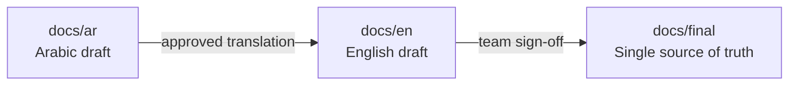
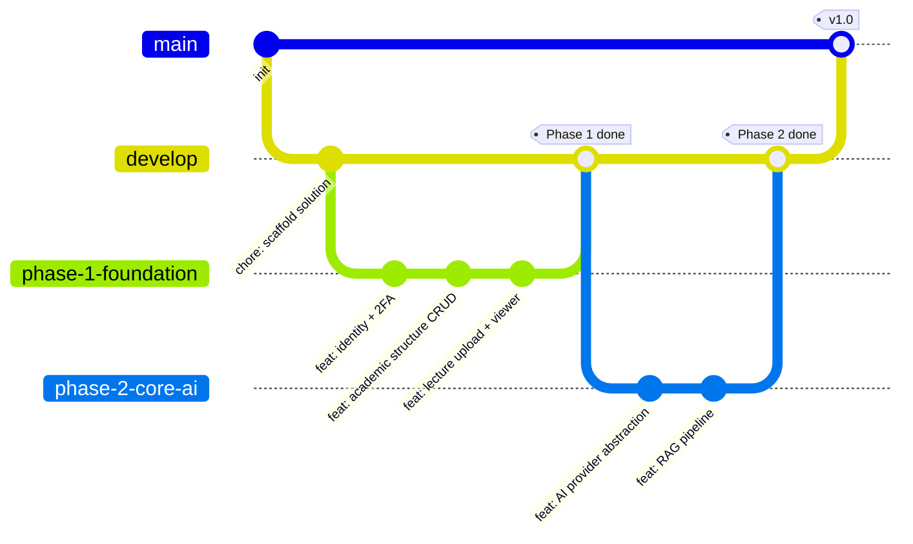

<div align="center">

# 📚 Muhadarati

**A dynamic university lecture platform with an AI study assistant and an in-browser code editor — built for IT students.**

[](#tech-stack)
[](#tech-stack)
[](#tech-stack)
[](#tech-stack)
[](#tech-stack)
[](#-documentation)
[](#-roadmap)
[](#-license)

</div>

---

## 📖 Overview

**Muhadarati** is a full‑stack academic platform for publishing and studying university lectures, built initially for a College of Information Technology (~2,000 students). Content is organized through a fully dynamic hierarchy — **College → Department → Stage → Subject → Lecture** — managed entirely from an admin panel, with nothing hard‑coded.

At its core sits an **AI study assistant** that is grounded in the lecture itself: it answers questions using Retrieval‑Augmented Generation (RAG) over the lecture's own content, and is always explicit when an answer extends beyond what the lecture covers. The same assistant explains, translates (Arabic ↔ English), and generates practice exams, reports, and presentations — each feature backed by its own independently swappable AI model.

Because the target audience is IT students, Muhadarati also ships a **Monaco‑based code editor** supporting Python, Java, C++, JavaScript, HTML and CSS, with safe in‑browser and sandboxed server‑side execution.

Student‑authored content — personal notes, chat history, exam results, saved code — is stored **entirely on the student's device**, keeping the server lean and putting students in control of their own data.

> 📌 **Project status:** planning & architecture. Full specification lives in [`docs/final`](../../tree/docs/final). See [Roadmap](#-roadmap) for what ships in each phase.

---

## 📑 Table of Contents

- [Key Features](#-key-features)
- [Tech Stack](#-tech-stack)
- [Documentation](#-documentation)
- [Branching Strategy](#-branching-strategy)
- [Roadmap](#-roadmap)
- [Getting Started](#-getting-started)
- [Contributing](#-contributing)
- [Team](#-team)
- [License](#-license)

---

## ✨ Key Features

### 🎓 Academic Content
- Fully dynamic structure — colleges, departments, stages, subjects and lectures are all managed from an admin panel, with support for multiple colleges from day one.
- Multi‑format lecture support (PDF, Word, PowerPoint, video, code, and more), with automatic conversion to PDF for in‑site viewing.
- Scoped, delegated supervision — the super admin can grant upload/edit/delete/news permissions down to the department, stage, or individual subject level.

### 🤖 AI Study Assistant
- **Lecture‑grounded Q&A (RAG):** answers are retrieved from the lecture's indexed content; when an answer isn't in the lecture, the assistant says so explicitly before answering from general knowledge.
- **Multi‑level explanations:** simplified, detailed, example‑driven, or beginner‑friendly — for a whole lecture or a selected passage.
- **Bidirectional translation:** Arabic ↔ English, preserving code and technical terms.
- **Self‑practice exams:** every question type (MCQ, true/false, short answer, essay, code‑writing, bug‑finding, and more), AI‑graded with feedback.
- **On‑demand reports and presentations:** Word/PDF reports and editable PowerPoint decks (capped at 20 slides), generated from lecture content or the student's own request.
- **One model per feature:** every AI capability resolves its own provider/model at runtime — no vendor lock‑in, easy to swap a cloud model for a local one.

### 💻 Code Editor
- Monaco‑powered editor (the engine behind VS Code) for Python, Java, C++, JavaScript, HTML & CSS.
- HTML/CSS/JS run in a sandboxed `iframe`; Python runs via Pyodide — both entirely in the browser.
- C++/Java run on a self‑hosted, Dockerized execution service (Judge0/Piston) with configurable time, memory, and output limits.

### 🧑‍🎓 Student Experience
- A fully personal workspace — students define their own sections (summaries, notes, reports, anything) and store notes, files, and AI outputs there.
- Everything in the personal workspace lives **on the student's device** (IndexedDB), with one‑click export/import for backup.
- Bilingual UI (Arabic/English) with automatic RTL/LTR switching, light/dark/system themes, and an installable PWA experience on mobile and desktop.

### 🛡️ Administration
- Multi‑level scoped supervisors (college → department → stage → subject), each with a full activity log.
- Academic announcements targeted by college, department, stage, or subject, with in‑site and email notifications.
- Usage analytics (views, downloads, AI usage per feature) and a student error‑report inbox.

---

## 🧱 Tech Stack

| Layer | Technology |
|---|---|
| **Backend API** | ASP.NET Core Web API on **.NET 10 (LTS)** |
| **Frontend** | **Blazor WebAssembly** |
| **Database** | **PostgreSQL** + **pgvector** (semantic search for RAG) |
| **Data access** | Entity Framework Core (Npgsql provider) |
| **Authentication** | ASP.NET Core Identity + two‑factor authentication (2FA) |
| **AI abstraction** | `Microsoft.Extensions.AI` — unified interface over local & cloud model providers |
| **Local AI runtime** | Ollama (or equivalent) for self‑hosted, free models |
| **Code editor** | Monaco Editor |
| **In‑browser execution** | Pyodide (Python) · sandboxed `iframe` (HTML/CSS/JS) |
| **Server‑side execution** | Judge0 / Piston, self‑hosted in isolated Docker containers (C++, Java) |
| **File conversion** | LibreOffice (headless) |
| **Client‑side storage** | IndexedDB (personal workspace, chat history, exam results, saved code) |
| **Delivery** | Installable Progressive Web App (PWA) |

---

## 📚 Documentation

Full project documentation is written **before** implementation and lives on its own branches, independent of the code branches:

| Branch | Content | Role |
|---|---|---|
| [`docs/ar`](../../tree/docs/ar) | `project-documentation-ar.md` | Arabic draft — discussion & translation source |
| [`docs/en`](../../tree/docs/en) | `project-documentation-en.md` | English draft — kept in sync with the Arabic draft |
| [`docs/final`](../../tree/docs/final) | Approved English documentation + `open-questions.md` | **Single source of truth** the team builds against |



Decisions still pending (e.g. registration method, AI provider selection, server specs) are tracked in `open-questions.md` on `docs/final` and removed from that list only once resolved — never silently assumed.

---

## 🌿 Branching Strategy

Muhadarati uses a **simplified GitHub Flow**: two long‑lived integration branches, one branch per implementation phase, and short‑lived task branches underneath. This keeps four engineers working in parallel without stepping on each other.



*(Phases 3–5 follow the exact same pattern and are omitted here only to keep the diagram readable.)*

### Branch reference

| Branch | Type | Purpose | Protected |
|---|---|---|---|
| **`main`** | Permanent | Always deployable. Only receives merges from `develop` (or `hotfix/*`) via reviewed PR. | ✅ |
| **`develop`** | Permanent | Integration branch where completed phases are combined and tested together. | ✅ |
| **`phase-1-foundation`** | Long‑lived | Dynamic structure, accounts/permissions/2FA, lecture upload & viewing, personal space, admin basics. | — |
| **`phase-2-core-ai`** | Long‑lived | AI provider abstraction, RAG indexing, lecture chat, explanation, translation. | — |
| **`phase-3-code-editor`** | Long‑lived | Monaco editor, in‑browser execution, C++/Java execution service, execution limits. | — |
| **`phase-4-advanced-ai`** | Long‑lived | Exam generation & grading, reports, presentations, code generation. | — |
| **`phase-5-news-notifications`** | Long‑lived | News section, notifications, email digest, error reports, analytics. | — |
| **`feature/phaseN-<short-desc>`** | Short‑lived | One engineer, one task. Branches from its phase branch; deleted after merge. | — |
| **`hotfix/<short-desc>`** | Short‑lived | Urgent production fix. Branches from `main`; merged back into **both** `main` and `develop`. | — |
| **`docs/ar`**, **`docs/en`**, **`docs/final`** | Permanent | See [Documentation](#-documentation) above. | ✅ (`docs/final` only) |

### Naming convention

```
feature/phase1-auth-2fa
feature/phase1-academic-structure
feature/phase2-rag-pipeline
feature/phase3-monaco-integration
feature/phase4-exam-grading
hotfix/fix-lecture-upload-crash
```

### Workflow

1. Branch from the relevant **phase branch** — not from `develop` or `main` directly.
2. Commit small, reviewable changes.
3. Open a **Pull Request into the phase branch**. At least one teammate reviews before merge.
4. Once a phase is feature‑complete and tested, its branch is merged into `develop` via PR.
5. `develop` is merged into `main` only when the merged result is deployable.
6. Merged feature branches are deleted automatically (GitHub setting: *Automatically delete head branches*).

---

## 🗺️ Roadmap

| Phase | Scope |
|---|---|
| **1 — Foundation** | Dynamic academic structure · accounts, roles & 2FA · lecture upload/viewing/conversion · personal workspace & backup · admin panel basics · activity log |
| **2 — Core AI** | Unified AI provider abstraction · lecture indexing (RAG) · lecture chat · explanation · translation |
| **3 — Code Editor** | Monaco integration · in‑browser execution (HTML/CSS/JS, Python) · C++/Java execution service · execution limits |
| **4 — Advanced AI** | Exam generation & AI grading · reports · presentations · code generation with run‑in‑editor |
| **5 — News & Notifications** | News section · automatic notifications · email digests · error reports · usage statistics |

Deferred beyond v1: interactive terminal for code execution, multi‑file projects for non‑web languages, native mobile app, additional colleges.

---

## 🚀 Getting Started

> This repository is currently in the **planning & architecture** stage — see [Documentation](#-documentation). Setup instructions below will be filled in as `phase-1-foundation` lands.

**Anticipated prerequisites:**
- [.NET 10 SDK](https://dotnet.microsoft.com/)
- [PostgreSQL 16+](https://www.postgresql.org/) with the [`pgvector`](https://github.com/pgvector/pgvector) extension
- [Docker](https://www.docker.com/) (for the sandboxed C++/Java execution service)

```bash
# placeholder — finalized once phase-1-foundation is scaffolded
git clone https://github.com/Math7-prog/Muhadarati.git
cd Muhadarati
git checkout develop
```

---

## 🤝 Contributing

1. Pick up a task from the current phase's board.
2. Branch from that phase branch using the [naming convention](#naming-convention) above.
3. Keep PRs small and scoped to one task.
4. Make sure the build and tests pass before requesting review.
5. Squash‑merge into the phase branch once approved.

---

## 👥 Team

A team of 4 engineers (growing), building Muhadarati end‑to‑end — backend, frontend, AI integration, and DevOps.

---

## 📄 License

License to be determined.

