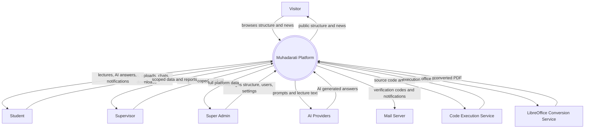
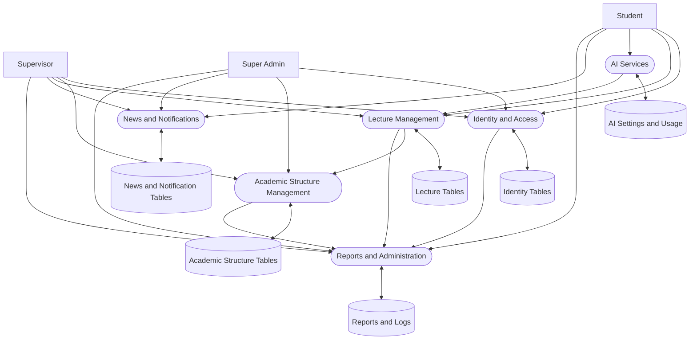
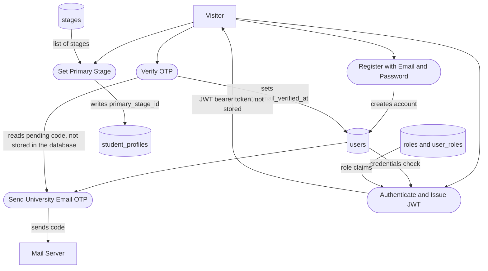
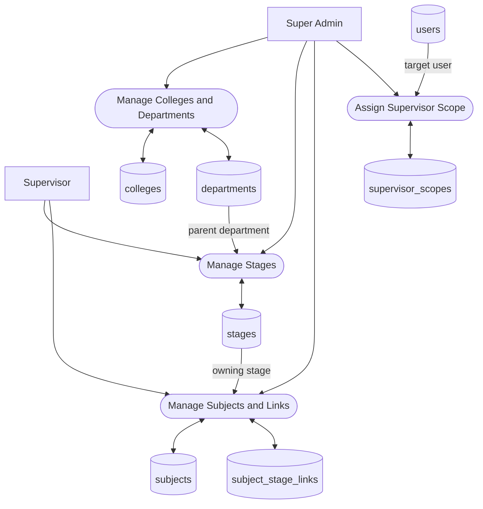
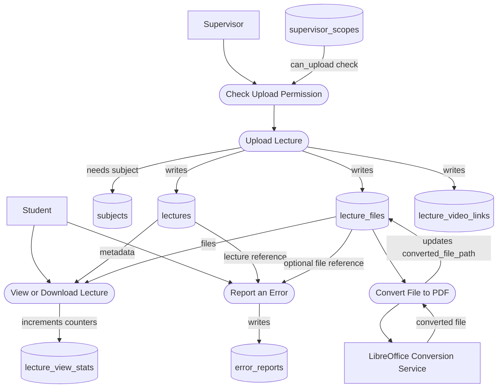
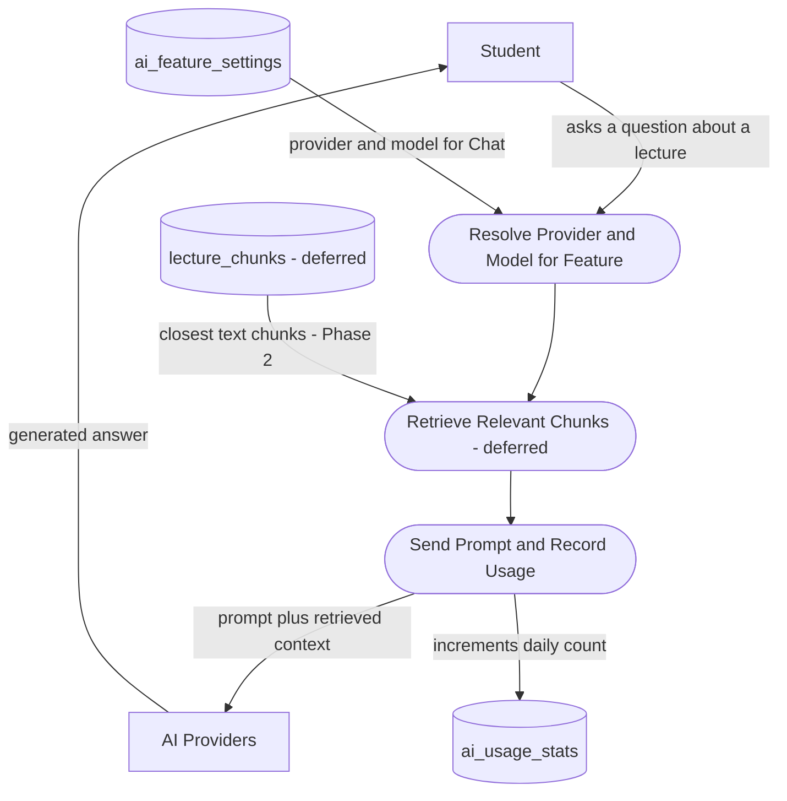
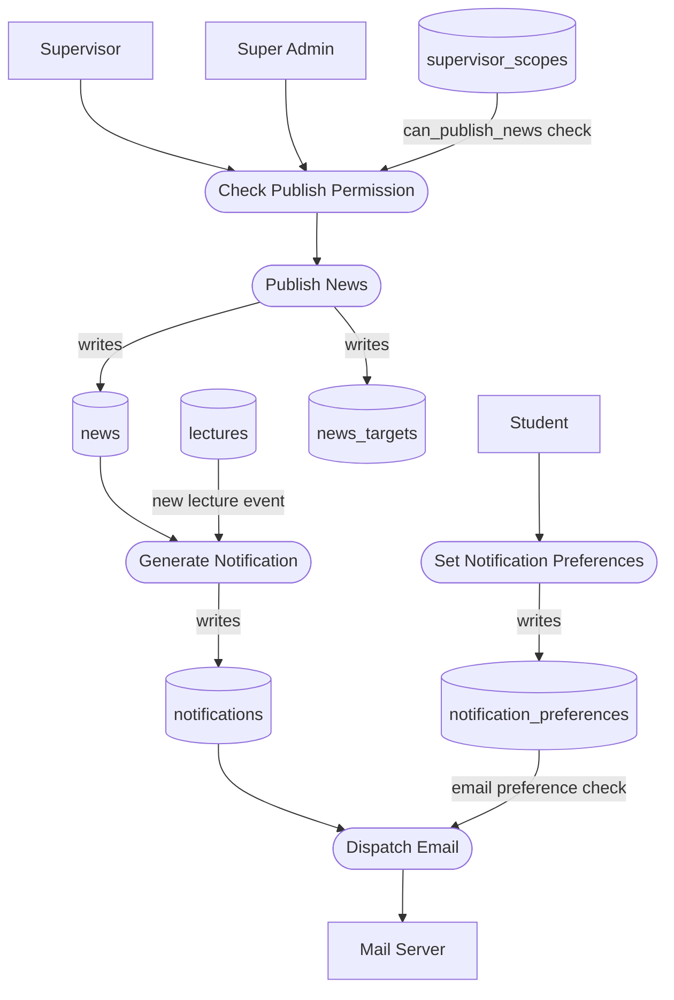
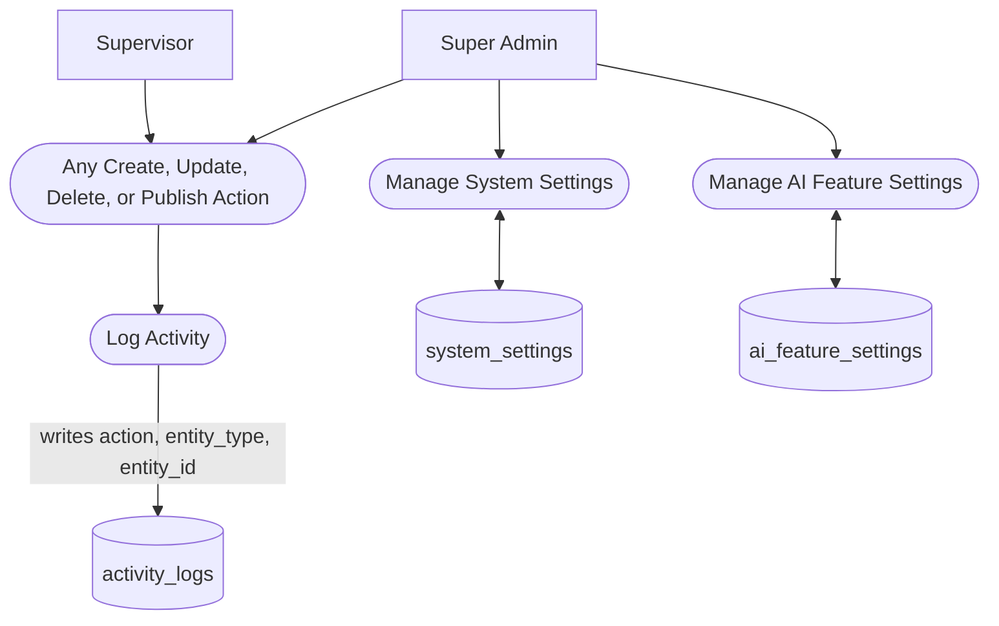

# Muhadarati — Data Flow Diagram (DFD)

> **Purpose:** shows how data actually moves through the system — who triggers what, which process touches which database table, and which external service is involved. This is the *behavioral* companion to `database-erd.md` (which shows *structure*). Every data store named below is a real table from `database-erd.md`; nothing here invents a table that does not exist there.
> **Scope:** flows for everything implemented so far (academic structure, Identity schema, lectures metadata, news, notifications, reports, admin settings), plus the AI-feature and registration-flow data paths exactly as agreed in the specification — marked **(planned)** where the business logic itself is not built yet, only the schema that will support it.
> **Notation:** [Mermaid](https://mermaid.js.org/syntax/flowchart.html) `flowchart`. Shapes follow standard DFD convention: a rectangle `[ ]` is an external entity, a rounded/stadium shape `([ ])` is a process, and a cylinder `[( )]` is a data store (a database table). Renders automatically on GitHub — no external tool needed.
> **Companion documents:** `database-erd.md` for schema structure; `project-documentation-ar.md` / `project-documentation-en.md` for the business rules behind each flow.

---

## 1. Context Diagram (Level 0)

The whole platform treated as a single process, showing only who/what it exchanges data with.

---

## 2. System Overview (Level 1)

The single process above, broken into its six major subsystems, each paired with the group of tables it owns.

---

## 3. Registration and Authentication *(planned business logic, schema already built)*

**Note:** the OTP code itself is intentionally never written to a persistent table (Section 3.1 of the specification) — it lives in a short-lived cache, which is why the diagram shows no data store for it.

---

## 4. Academic Structure Management

---

## 5. Lecture Upload, Viewing and Error Reporting

---

## 6. AI Feature Request *(RAG chat path shown; other features follow the same shape)*

---

## 7. News Publishing and Notifications

---

## 8. Activity Logging and System Administration *(cross-cutting)*

**Note:** Step P1 to P2 represents every write operation shown in Sections 3 to 7 above — uploading a lecture, publishing news, editing the academic structure, and so on. It is drawn once here rather than repeated on every earlier diagram, to keep each of them readable.

---

## Change log

| Date | Change |
|---|---|
| October 31, 2026 | Initial version — eight diagrams covering context, system overview, and all six major subsystems, grounded in the 28 implemented tables from `database-erd.md` |
