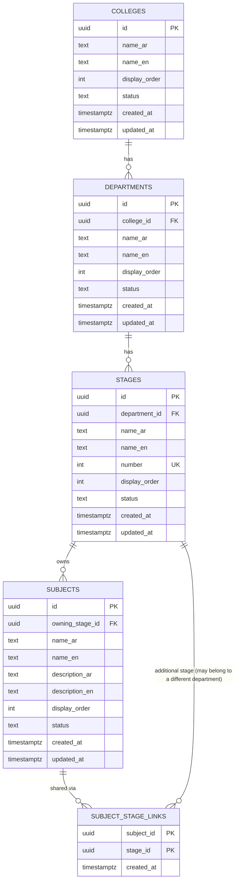
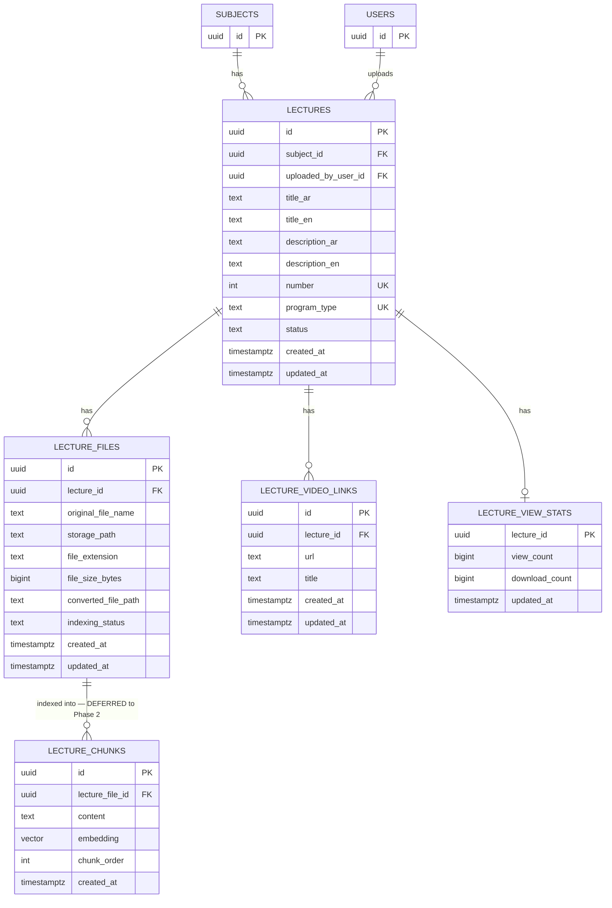
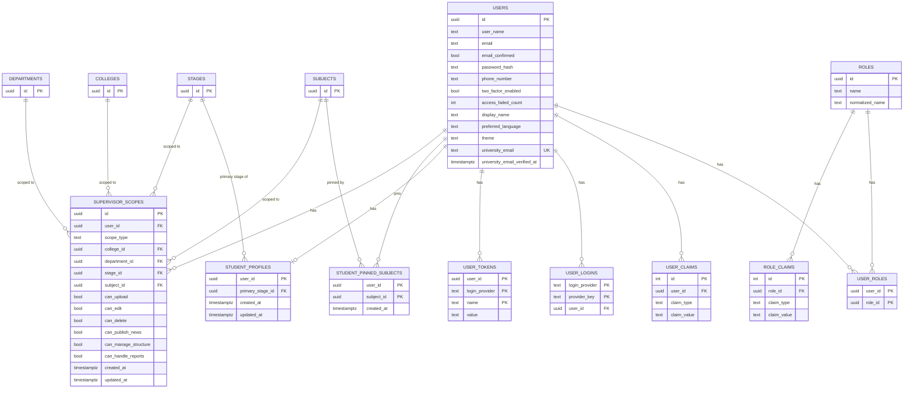
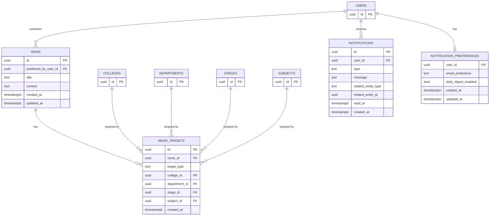
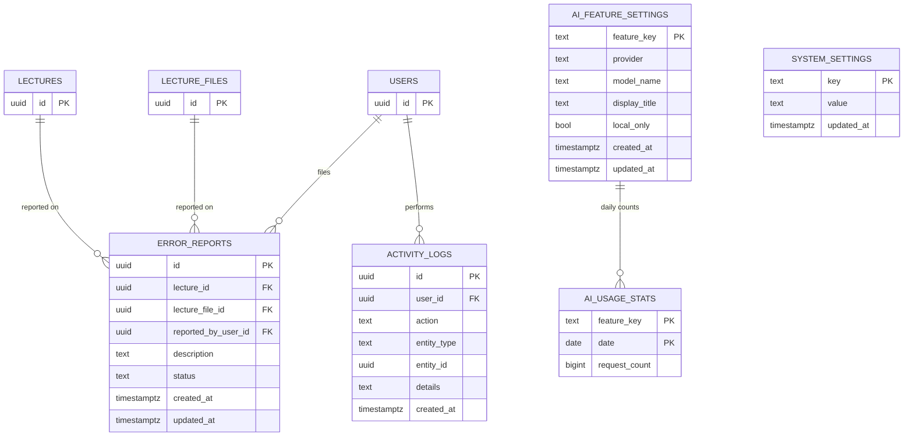

# Muhadarati — Database Entity-Relationship Diagram

> **Source of truth:** this file documents the schema exactly as implemented by EF Core migrations `InitialAcademicStructure`, `EnablePgvectorExtension`, and `AddIdentityAndCoreTables`, applied and verified on October 31, 2026.
> **Scope:** every table and relationship agreed upon so far — 28 tables actually created in the database, plus `lecture_chunks` (⏸️ deferred to Phase 2, shown for completeness of the agreed design).
> **Companion document:** `project-documentation-ar.md` / `project-documentation-en.md`, Sections 14.1, 14.1.1 and 14.1.2, for field-level prose explanations, business rules, and the reasoning behind each design decision.
> **Notation:** [Mermaid](https://mermaid.js.org/syntax/entityRelationshipDiagram.html) `erDiagram`. Renders automatically as a diagram on GitHub, GitLab, and most Markdown viewers — no external tool required. Keep this file as the single place to update when the schema changes; it stays reviewable through normal `git diff`.

---

## How to read this file

- **PK** = primary key, **FK** = foreign key, **UK** = part of a unique constraint (simple or composite).
- A dashed note under a diagram documents anything Mermaid's ER notation cannot express visually: `CHECK` constraints, partial unique indexes, and foreign keys that are intentionally *not* enforced at the database level.
- Relationship cardinality: `||` = exactly one, `o|` = zero or one, `o{` = zero or many, `|{` = one or many.
- Section 1 is the **single complete diagram** — every table, every relationship, nothing omitted. It is large by necessity.
- Sections 2–6 are the **same schema regrouped by domain**, purely for readability. No table or relationship here is new or different from Section 1 — each one simply repeats the relevant slice, occasionally showing a referenced table from another domain with no attributes listed (a "stub") purely to make the connecting relationship visible.

---

## 1. Complete Schema (all 28 implemented tables + 1 deferred)

```mermaid
erDiagram
    COLLEGES {
        uuid id PK
        text name_ar
        text name_en
        int display_order
        text status
        timestamptz created_at
        timestamptz updated_at
    }
    DEPARTMENTS {
        uuid id PK
        uuid college_id FK
        text name_ar
        text name_en
        int display_order
        text status
        timestamptz created_at
        timestamptz updated_at
    }
    STAGES {
        uuid id PK
        uuid department_id FK
        text name_ar
        text name_en
        int number UK
        int display_order
        text status
        timestamptz created_at
        timestamptz updated_at
    }
    SUBJECTS {
        uuid id PK
        uuid owning_stage_id FK
        text name_ar
        text name_en
        text description_ar
        text description_en
        int display_order
        text status
        timestamptz created_at
        timestamptz updated_at
    }
    SUBJECT_STAGE_LINKS {
        uuid subject_id PK
        uuid stage_id PK
        timestamptz created_at
    }
    LECTURES {
        uuid id PK
        uuid subject_id FK
        uuid uploaded_by_user_id FK
        text title_ar
        text title_en
        text description_ar
        text description_en
        int number UK
        text program_type UK
        text status
        timestamptz created_at
        timestamptz updated_at
    }
    LECTURE_FILES {
        uuid id PK
        uuid lecture_id FK
        text original_file_name
        text storage_path
        text file_extension
        bigint file_size_bytes
        text converted_file_path
        text indexing_status
        timestamptz created_at
        timestamptz updated_at
    }
    LECTURE_VIDEO_LINKS {
        uuid id PK
        uuid lecture_id FK
        text url
        text title
        timestamptz created_at
        timestamptz updated_at
    }
    LECTURE_CHUNKS {
        uuid id PK
        uuid lecture_file_id FK
        text content
        vector embedding
        int chunk_order
        timestamptz created_at
    }
    LECTURE_VIEW_STATS {
        uuid lecture_id PK
        bigint view_count
        bigint download_count
        timestamptz updated_at
    }
    USERS {
        uuid id PK
        text user_name
        text email
        bool email_confirmed
        text password_hash
        text phone_number
        bool two_factor_enabled
        int access_failed_count
        text display_name
        text preferred_language
        text theme
        text university_email UK
        timestamptz university_email_verified_at
    }
    ROLES {
        uuid id PK
        text name
        text normalized_name
    }
    USER_ROLES {
        uuid user_id PK
        uuid role_id PK
    }
    USER_CLAIMS {
        int id PK
        uuid user_id FK
        text claim_type
        text claim_value
    }
    USER_LOGINS {
        text login_provider PK
        text provider_key PK
        uuid user_id FK
    }
    USER_TOKENS {
        uuid user_id PK
        text login_provider PK
        text name PK
        text value
    }
    ROLE_CLAIMS {
        int id PK
        uuid role_id FK
        text claim_type
        text claim_value
    }
    STUDENT_PROFILES {
        uuid user_id PK
        uuid primary_stage_id FK
        timestamptz created_at
        timestamptz updated_at
    }
    STUDENT_PINNED_SUBJECTS {
        uuid user_id PK
        uuid subject_id PK
        timestamptz created_at
    }
    SUPERVISOR_SCOPES {
        uuid id PK
        uuid user_id FK
        text scope_type
        uuid college_id FK
        uuid department_id FK
        uuid stage_id FK
        uuid subject_id FK
        bool can_upload
        bool can_edit
        bool can_delete
        bool can_publish_news
        bool can_manage_structure
        bool can_handle_reports
        timestamptz created_at
        timestamptz updated_at
    }
    NEWS {
        uuid id PK
        uuid published_by_user_id FK
        text title
        text content
        timestamptz created_at
        timestamptz updated_at
    }
    NEWS_TARGETS {
        uuid id PK
        uuid news_id FK
        text target_type
        uuid college_id FK
        uuid department_id FK
        uuid stage_id FK
        uuid subject_id FK
        timestamptz created_at
    }
    NOTIFICATIONS {
        uuid id PK
        uuid user_id FK
        text type
        text message
        text related_entity_type
        uuid related_entity_id
        timestamptz read_at
        timestamptz created_at
    }
    NOTIFICATION_PREFERENCES {
        uuid user_id PK
        text email_preference
        bool daily_digest_enabled
        timestamptz created_at
        timestamptz updated_at
    }
    ERROR_REPORTS {
        uuid id PK
        uuid lecture_id FK
        uuid lecture_file_id FK
        uuid reported_by_user_id FK
        text description
        text status
        timestamptz created_at
        timestamptz updated_at
    }
    ACTIVITY_LOGS {
        uuid id PK
        uuid user_id FK
        text action
        text entity_type
        uuid entity_id
        text details
        timestamptz created_at
    }
    AI_FEATURE_SETTINGS {
        text feature_key PK
        text provider
        text model_name
        text display_title
        bool local_only
        timestamptz created_at
        timestamptz updated_at
    }
    SYSTEM_SETTINGS {
        text key PK
        text value
        timestamptz updated_at
    }
    AI_USAGE_STATS {
        text feature_key PK
        date date PK
        bigint request_count
    }

    COLLEGES ||--o{ DEPARTMENTS : has
    DEPARTMENTS ||--o{ STAGES : has
    STAGES ||--o{ SUBJECTS : owns
    SUBJECTS ||--o{ SUBJECT_STAGE_LINKS : "shared via"
    STAGES ||--o{ SUBJECT_STAGE_LINKS : "additional stage"
    SUBJECTS ||--o{ LECTURES : has
    LECTURES ||--o{ LECTURE_FILES : has
    LECTURES ||--o{ LECTURE_VIDEO_LINKS : has
    LECTURES ||--o| LECTURE_VIEW_STATS : has
    LECTURE_FILES ||--o{ LECTURE_CHUNKS : "indexed into (deferred)"
    USERS ||--o{ LECTURES : uploads

    USERS ||--o{ USER_ROLES : has
    ROLES ||--o{ USER_ROLES : has
    USERS ||--o{ USER_CLAIMS : has
    USERS ||--o{ USER_LOGINS : has
    USERS ||--o{ USER_TOKENS : has
    ROLES ||--o{ ROLE_CLAIMS : has
    USERS ||--o| STUDENT_PROFILES : has
    STAGES ||--o{ STUDENT_PROFILES : "primary stage of"
    USERS ||--o{ STUDENT_PINNED_SUBJECTS : pins
    SUBJECTS ||--o{ STUDENT_PINNED_SUBJECTS : "pinned by"
    USERS ||--o{ SUPERVISOR_SCOPES : has
    COLLEGES ||--o{ SUPERVISOR_SCOPES : "scoped to"
    DEPARTMENTS ||--o{ SUPERVISOR_SCOPES : "scoped to"
    STAGES ||--o{ SUPERVISOR_SCOPES : "scoped to"
    SUBJECTS ||--o{ SUPERVISOR_SCOPES : "scoped to"

    USERS ||--o{ NEWS : publishes
    NEWS ||--o{ NEWS_TARGETS : has
    COLLEGES ||--o{ NEWS_TARGETS : "targeted by"
    DEPARTMENTS ||--o{ NEWS_TARGETS : "targeted by"
    STAGES ||--o{ NEWS_TARGETS : "targeted by"
    SUBJECTS ||--o{ NEWS_TARGETS : "targeted by"
    USERS ||--o{ NOTIFICATIONS : receives
    USERS ||--o| NOTIFICATION_PREFERENCES : has

    LECTURES ||--o{ ERROR_REPORTS : "reported on"
    LECTURE_FILES ||--o{ ERROR_REPORTS : "reported on"
    USERS ||--o{ ERROR_REPORTS : files
    USERS ||--o{ ACTIVITY_LOGS : performs
    AI_FEATURE_SETTINGS ||--o{ AI_USAGE_STATS : "daily counts"
```

**What Mermaid cannot show above (documented, not omitted):**
- `supervisor_scopes` and `news_targets`: a `CHECK (num_nonnulls(college_id, department_id, stage_id, subject_id) = 1)` constraint, plus four partial unique indexes (one per `scope_type`/`target_type`) instead of one composite unique index — see Section 14.1.2 of the specification for why a single composite index does not work with nullable columns in Postgres.
- `activity_logs.entity_id`: **no** real foreign key, by design — the set of possible `entity_type` values is open-ended.
- `notifications.related_entity_id`: same reason, also by design.
- `student_profiles`, `notification_preferences`, `lecture_view_stats`: true 1:1 relationships with **no independent `id`** — their primary key *is* the foreign key.
- `subject_stage_links`, `student_pinned_subjects`: pure link tables, composite primary key, no independent `id`.
- Every enum-typed column (`status`, `program_type`, `scope_type`, `target_type`, `type`, `indexing_status`, `email_preference`, `action`) is stored as `text`, not an integer.

---

## 2. Domain: Academic Structure

**Note:** the hierarchy is College → Department → Stage → Subject → Lecture. `subject_stage_links` is the only many-to-many point in this whole schema: it lets one subject's lectures appear under more than one stage — even a stage in a different department — without re-uploading anything.

---

## 3. Domain: Lectures & Files

**Note:** `lecture_chunks` is not yet created in the database — it is pending the embedding-model decision (Open Question 3), which fixes the vector's dimension. Shown here only to keep this document a complete picture of the agreed design, matching Section 14.1 of the specification.

---

## 4. Domain: Identity & Access

**Note:** `users` through `role_claims` are the seven standard ASP.NET Core Identity tables (renamed from the `AspNet*` prefix). Only three roles exist as data: `Student`, `Supervisor`, `Admin` — coarse classification only. The fine-grained "which scope, which permission" detail lives entirely in `supervisor_scopes`, whose `college_id`/`department_id`/`stage_id`/`subject_id` columns are mutually exclusive (exactly one populated per row, enforced by a `CHECK` constraint — see Section 1's notes).

---

## 5. Domain: News & Notifications

**Note:** `news.title`/`news.content` are single free-text fields (not bilingual like the academic structure) — a publisher writes an announcement once, in one language. `notifications.related_entity_type`/`related_entity_id` is an intentionally unconstrained pointer (to a lecture or a news item), added beyond the original specification so a notification can be clicked through to its source.

---

## 6. Domain: Reports, Admin & Statistics

**Note:** `activity_logs.entity_id` has no real foreign key (by design — too many possible target types; see Section 1). `system_settings` is a genuinely open key/value store (`key` is free text, not an enum), unlike `ai_feature_settings` whose `feature_key` is one of eight fixed values (`Chat`, `Explanation`, `Translation`, `ExamGeneration`, `ExamGrading`, `Reports`, `Presentations`, `CodeGeneration`).

---

## Change log

| Date | Change |
|---|---|
| October 31, 2026 | Initial version — covers migrations `InitialAcademicStructure`, `EnablePgvectorExtension`, `AddIdentityAndCoreTables` (28 tables) + the deferred `lecture_chunks` design |
