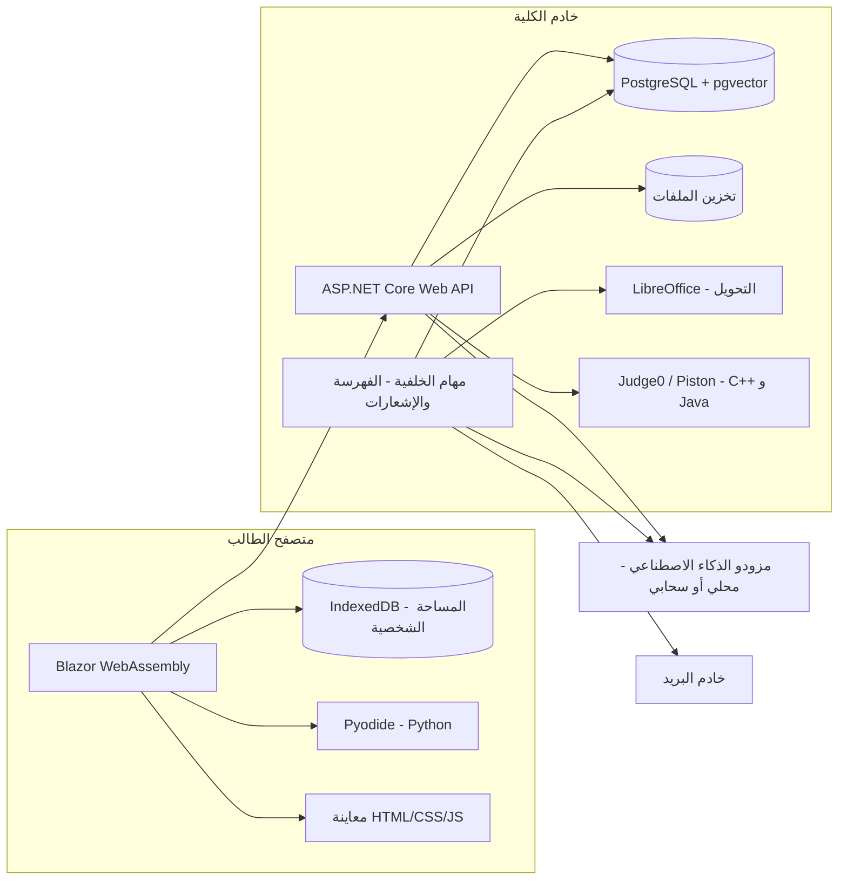

# وثيقة مشروع منصة المحاضرات الجامعية

> **اسم المشروع:** [لم يُحدد بعد]
> **الإصدار:** 1.0 (مسودة أولى)
> **التاريخ:** 31 أكتوبر 2026
> **الحالة:** قيد المراجعة من الفريق
> **ملاحظة:** النقاط التي لم تُحسم بعد موثّقة في ملف مستقل: `open-questions.md`

---

## جدول المحتويات

1. [نظرة عامة](#1-نظرة-عامة)
2. [المستخدمون والأدوار والصلاحيات](#2-المستخدمون-والأدوار-والصلاحيات)
3. [الحسابات والتسجيل](#3-الحسابات-والتسجيل)
4. [الهيكل الأكاديمي الديناميكي](#4-الهيكل-الأكاديمي-الديناميكي)
5. [المحاضرات والملفات](#5-المحاضرات-والملفات)
6. [المساحة الشخصية للطالب](#6-المساحة-الشخصية-للطالب)
7. [الذكاء الاصطناعي](#7-الذكاء-الاصطناعي)
8. [محرر الأكواد](#8-محرر-الأكواد)
9. [الأخبار والإشعارات](#9-الأخبار-والإشعارات)
10. [لوحة التحكم](#10-لوحة-التحكم)
11. [الواجهة والتصميم](#11-الواجهة-والتصميم)
12. [المتطلبات غير الوظيفية](#12-المتطلبات-غير-الوظيفية)
13. [البنية التقنية](#13-البنية-التقنية)
14. [نموذج البيانات المبدئي](#14-نموذج-البيانات-المبدئي)
15. [خطة التنفيذ](#15-خطة-التنفيذ)
16. [مسرد المصطلحات](#16-مسرد-المصطلحات)

---

## 1. نظرة عامة

### 1.1 الفكرة
منصة ويب لنشر المحاضرات الجامعية، منظّمة حسب الهيكل الأكاديمي للكلية: الأقسام، ثم المراحل، ثم المواد، ثم المحاضرات. تدمج المنصة الذكاء الاصطناعي لمساعدة الطالب على فهم المحاضرات وترجمتها، وإنشاء التقارير والعروض التقديمية، والتدرّب بالامتحانات، وكتابة الأكواد وتشغيلها في محرر مدمج.

### 1.2 الأهداف
- **مكان واحد** لكل محاضرات الكلية، منظّم ويسهل الوصول إليه.
- **مساعد ذكي مرتبط بالمحاضرة نفسها**، يجيب من محتواها ويوضح بصراحة متى تكون الإجابة من خارجها.
- **بيئة برمجية مدمجة** تناسب طلبة تقنية المعلومات.
- **حل مجاني** قدر الإمكان من ناحية البرمجيات والخدمات.

### 1.3 الفئة المستهدفة
- **حالياً:** طلبة كلية تقنية المعلومات، الدراستان الصباحية والمسائية (قرابة 2000 طالب).
- **مستقبلاً:** كليات أخرى.

### 1.4 طبيعة المشروع
- منتج حقيقي سيُطلق للطلاب، وليس نموذجاً تجريبياً.
- يطوّره فريق من 4 أعضاء (قابل للزيادة).
- لا يوجد موعد نهائي، والمطلوب إنجازه بأسرع وقت ممكن.
- الاستضافة توفرها الكلية.

### 1.5 المبادئ الحاكمة
هذه المبادئ تنطبق على كل قرار في المشروع:

| المبدأ | المعنى |
|---|---|
| **الديناميكية الكاملة** | لا شيء مثبت في الكود: الكليات والأقسام والمراحل والمواد وحدود الملفات وحدود تشغيل الأكواد ومزودو الذكاء الاصطناعي، كلها تُدار من لوحة التحكم |
| **الجاهزية لعدة كليات** | البنية تدعم أكثر من كلية من اليوم الأول، حتى لو بدأ التشغيل بكلية واحدة |
| **نموذج لكل ميزة** | كل ميزة ذكاء اصطناعي لها مزود ونموذج مستقل يمكن تبديله دون تعديل الكود |
| **البيانات الشخصية في جهاز الطالب** | المحاضرات على الخادم، أما المساحة الشخصية والمحادثات ونتائج الامتحانات فتُخزن في جهاز الطالب |
| **المجانية** | الاعتماد على أدوات مفتوحة المصدر وخدمات مجانية، مع تجنب أي تكاليف اشتراك |

---

## 2. المستخدمون والأدوار والصلاحيات

### 2.1 الأدوار

| الدور | الوصف |
|---|---|
| **الزائر** | يتصفح الهيكل الأكاديمي (الأقسام، المراحل، المواد، عناوين المحاضرات) والأخبار العامة فقط |
| **الطالب** | يفتح المحاضرات ويحمّلها، ويستخدم الذكاء الاصطناعي والمحرر والمساحة الشخصية |
| **المشرف** | يدير المحتوى ضمن نطاق محدد يعيّنه له الأدمن |
| **الأدمن العام** | صلاحيات كاملة على المنصة، وهو الوحيد الذي يعيّن المشرفين |

### 2.2 مستويات الإشراف
كل مستوى يدير ما تحته فقط:

**الأدمن العام ← مشرف كلية ← مشرف قسم ← مشرف مرحلة ← مشرف مادة**

- مشرف القسم مثلاً يدير كل مراحل قسمه وموادها، ولا يرى أقساماً أخرى.
- يمكن أن يكون للمشرف الواحد أكثر من نطاق (مثلاً مشرف على مادتين في مرحلتين مختلفتين).

### 2.3 أنواع الصلاحيات
يحدد الأدمن لكل مشرف، ضمن نطاقه، أياً من الصلاحيات التالية:

| الصلاحية | الوصف |
|---|---|
| **رفع** | إضافة محاضرات وملفات جديدة |
| **تعديل** | تعديل بيانات المحاضرات واستبدال ملفاتها |
| **حذف** | حذف المحاضرات والملفات |
| **نشر أخبار** | نشر أخبار موجهة لنطاقه فقط |
| **إدارة الهيكل** | إضافة مراحل أو مواد ضمن نطاقه (اختيارية) |
| **معالجة البلاغات** | استلام بلاغات الطلاب عن الأخطاء في نطاقه |

### 2.4 قواعد الصلاحيات
- **الأدمن العام فقط** يعيّن المشرفين ويحدد نطاقاتهم وصلاحياتهم. المشرف لا يستطيع تعيين مشرفين آخرين.
- **التحقق من الهوية إلزامي** للمشرفين والأدمن: تسجيل دخول مع **مصادقة ثنائية (2FA)**.
- **سجل نشاط** يوثّق كل إجراء يقوم به المشرفون (انظر 10.4).

---

## 3. الحسابات والتسجيل

### 3.1 طريقة التسجيل (محسوم)
التسجيل يتم عبر **ASP.NET Core Identity** على خطوتين منفصلتين:

1. **تسجيل أساسي:** يسجّل الطالب بأي بريد إلكتروني وكلمة مرور من اختياره، بشرط أن تكون كلمة المرور **مزيجاً من الحروف والأرقام والرموز** (سياسة تعقيد قياسية). هذا التسجيل كافٍ لفتح المحاضرات وتحميلها.
2. **تحقق إضافي لفتح الذكاء الاصطناعي:** يُدخل الطالب بريده الجامعي، فيُرسَل إليه **رمز تحقق (OTP)**. بعد إدخاله بنجاح تُفعَّل ميزات الذكاء الاصطناعي كاملة (المحادثة، الشرح، الترجمة، الامتحانات، التقارير، العروض، تشغيل الأكواد).

**القواعد المرتبطة:**
- **الزائر غير المسجَّل:** يتصفح الهيكل والأخبار العامة فقط (دون فتح أو تحميل المحاضرات).
- **قيد تفرّد على البريد الجامعي الموثَّق:** لا يمكن توثيق أكثر من حساب بنفس البريد الجامعي. هذا وحده يحل عملياً مشكلة تعدد الحسابات واستهلاك الذكاء الاصطناعي المضاعف، دون الحاجة لحد استخدام صارم من اليوم الأول.
- **حماية أداء اختيارية:** تبقى لوحة التحكم قادرة على ضبط حد استخدام يومي لكل ميزة إذا احتاج الخادم لذلك مستقبلاً، كإجراء لحماية الأداء وليس لمنع الغش (المشكلة الأخيرة محلولة أصلاً بقيد التفرّد أعلاه).
- خادم البريد الذي يرسل رمز التحقق هو نفسه خادم الإشعارات، وتفاصيله في `open-questions.md`.

### 3.2 المرحلة الأساسية وتصفح المراحل
- يحدد الطالب **مرحلته الأساسية** عند التسجيل، فتظهر موادها في صفحته الرئيسية مباشرة.
- يستطيع **تصفح كل المراحل** واستخدام الذكاء الاصطناعي على أي محاضرة.
- يستطيع **إضافة مواد من مراحل أخرى** إلى صفحته الرئيسية، مثلاً للمواد المحمّلة من مرحلة سابقة.
- يستطيع تغيير مرحلته الأساسية لاحقاً (عند الانتقال لمرحلة جديدة).

### 3.3 عند التسجيل
- يظهر **إشعار خصوصية** يوضح أن محتوى المحاضرات والأسئلة قد يُعالج عبر مزودي ذكاء اصطناعي خارجيين، دون إرسال أي بيانات شخصية.
- يختار الطالب **تفضيلات الإشعارات** (انظر القسم 9).

---

## 4. الهيكل الأكاديمي الديناميكي

### 4.1 التسلسل

**الكلية ← القسم ← المرحلة ← المادة ← المحاضرة**

### 4.2 القواعد
- **كل المستويات تُدار ديناميكياً** من لوحة التحكم: إضافة، تعديل، إعادة ترتيب، إخفاء.
- **المواد يضيفها الأدمن** (أو المشرف المخوّل بصلاحية إدارة الهيكل ضمن نطاقه).
- **عند تحديث قسم أو مادة** (تغيير اسم، دمج، إضافة جديد) يتم ذلك من اللوحة دون أي تعديل برمجي.
- **مقترح:** استخدام **الإخفاء أو الأرشفة** بدل الحذف النهائي للأقسام والمواد، حتى لا تضيع المحاضرات المرتبطة بها.
- **مواد مشتركة بين عدة مراحل (محسوم):** توجد مادة أو مادتان مشتركتان فعلياً. النظام يدعم ربط المادة الواحدة بأكثر من مرحلة عبر جدول ربط (`SubjectStageLinks`)، فتُرفع محاضراتها مرة واحدة وتظهر تلقائياً في كل المراحل المرتبطة، دون تكرار الرفع.
- **الدراسة الصباحية والمسائية (محسوم):** المحاضرات مشتركة افتراضياً بين الدراستين. إذا اختلف محتوى محاضرة معينة بينهما، تُرفع نسخة إضافية ويُوسَم كل إصدار بوسم "صباحي" أو "مسائي"، دون إضافة مستوى جديد إلى الهيكل.

---

## 5. المحاضرات والملفات

### 5.1 رفع المحاضرات
- يرفعها الأدمن والمشرفون حسب صلاحياتهم ونطاقهم.
- **المحاضرة الواحدة يمكن أن تحتوي أكثر من ملف.**
- بيانات المحاضرة: العنوان، الوصف، رقم أو ترتيب المحاضرة، المادة التابعة لها، الملفات المرفقة، تاريخ الرفع، اسم الرافع، ونوع البرنامج (مشترك افتراضياً، أو صباحي/مسائي عند الاختلاف).
- **كل صيغ الملفات مسموحة للرفع والتحميل.**

### 5.2 العرض داخل الموقع
- **صيغ تُعرض داخل الموقع:** PDF، Word، PowerPoint، الصور، الملفات النصية، ملفات الأكواد.
- **باقي الصيغ:** تُحمّل فقط ولا تُعرض.

### 5.3 تحويل الصيغ
- **تحويل تلقائي** إلى PDF عند رفع ملفات Word وPowerPoint وما يشابهها، باستخدام LibreOffice على الخادم (مجاني ومفتوح المصدر).
- **زر تحويل يدوي** للحالات التي لا يقبل فيها الذكاء الاصطناعي صيغة الملف.
- يُحتفظ بالملف الأصلي دائماً إلى جانب النسخة المحوّلة.

### 5.4 الفيديو
- رفع ملفات الفيديو مباشرة ضمن الحد المسموح.
- **دعم روابط YouTube غير المدرجة (Unlisted)** كبديل للرفع، لتخفيف الضغط على مساحة الخادم وسرعة الشبكة.

### 5.5 حدود الأحجام
القيم التالية افتراضية، **وتُعدّل من لوحة التحكم**:

| النوع | الحد الافتراضي |
|---|---|
| مستندات (PDF، Word، PowerPoint) | 100 ميغابايت |
| صور | 20 ميغابايت |
| ملفات مضغوطة وصيغ أخرى | 200 ميغابايت |
| فيديو | 1 غيغابايت |
| ملفات المساحة الشخصية | بلا حد من الخادم (تُخزن في جهاز الطالب) |

### 5.6 التحميل (محسوم)
- **التحميل مسموح دائماً** لكل الطلاب المسجلين، على كل المحاضرات، بلا استثناء وبلا خيار لتعطيله.
- لا يوجد في النظام خيار "عرض فقط". إذا رفض أستاذ مبدأ إتاحة التحميل، فالحل هو **عدم نشر محاضراته على المنصة أصلاً**، لا نشرها مقيّدة.

### 5.7 الفهرسة للذكاء الاصطناعي
- عند رفع أي محاضرة، يُستخرج نصها **تلقائياً في الخلفية** ويُفهرس ليصبح قابلاً للبحث الدلالي (انظر 7.2).
- عند تعديل ملف أو حذفه، تُحدّث الفهرسة تلقائياً.

### 5.8 الإبلاغ عن الأخطاء
- يستطيع الطالب الإبلاغ عن خطأ في محاضرة أو ملف تالف أو ناقص.
- يصل البلاغ إلى **المشرف المسؤول عن نطاق المحاضرة**، ويتابع حالته (جديد، قيد المعالجة، تم الحل).

---

## 6. المساحة الشخصية للطالب

### 6.1 المفهوم
لكل طالب مساحة خاصة لا يراها غيره، **يُنشئ فيها أقسامه بنفسه حسب ذوقه** (مثل: ملخصات، ملاحظات، تقارير، أو أي تسمية يختارها).

### 6.2 المحتوى المسموح
- **ملاحظات** يكتبها بمحرر نصوص منسّق.
- **ملفات** يرفعها من جهازه.
- **مخرجات الذكاء الاصطناعي** (تقرير، شرح، امتحان، كود) تُحفظ مباشرة في أحد أقسامه.
- **نسخ محاضرة** من الموقع إلى أحد أقسامه.
- **أكواد** محفوظة من المحرر.

### 6.3 التخزين
- **كل محتوى المساحة الشخصية يُخزن في جهاز الطالب** (داخل المتصفح عبر IndexedDB)، وليس على الخادم.
- يستطيع الطالب **تحميل أي ملف** من مساحته إلى جهازه.

### 6.4 النسخ الاحتياطي
- **تصدير نسخة احتياطية** كاملة في ملف يُحفظ في جهاز الطالب (وليس على الخادم).
- **استيراد النسخة** على أي جهاز أو متصفح آخر.
- **تذكير دوري** للطالب بعمل نسخة احتياطية.
- **تنبيه واضح** للطالب بأن مسح بيانات المتصفح أو تغيير الجهاز دون نسخة احتياطية يعني فقدان المساحة الشخصية.

---

## 7. الذكاء الاصطناعي

### 7.1 مبدأ "نموذج لكل ميزة"
- كل ميزة لها **مزود ونموذج مستقل** يُضبط من لوحة التحكم: الإجابة من المحاضرة، الشرح، الترجمة، الامتحانات، تصحيح الامتحانات، التقارير، العروض التقديمية، الأكواد.
- يُبنى ذلك عبر **واجهة موحّدة** في الكود (`Microsoft.Extensions.AI`)، وتحتها محوّلات لكل مزود: نماذج محلية (مثل Ollama)، خدمات سحابية بطبقة مجانية، أو أي نموذج يُدرَّب لاحقاً.
- **الهدف:** اختيار أفضل نموذج مجاني متخصص لكل مهمة، بدل البحث عن نموذج واحد يلبي كل الاحتياجات.
- **شرط اختيار أي نموذج:** اختبار جودة العربية فيه قبل اعتماده.
- **اقتراحات أولية غير نهائية** لأنسب النماذج المجانية لكل ميزة موثّقة في `open-questions.md`، وهي مطروحة للنقاش لا للاعتماد المباشر.

### 7.2 الإجابة من المحاضرة (RAG)
المنصة **لا تدرّب نموذجاً** في الإصدار الأول، بل تعتمد على تقنية الاسترجاع المعزّز (RAG):

1. **استخراج النص** من المحاضرة عند الرفع.
2. **تقسيم النص** إلى مقاطع صغيرة.
3. **تحويل المقاطع إلى متجهات** باستخدام نموذج تضمين مفتوح المصدر يدعم العربية والإنجليزية، ويعمل على المعالج العادي دون بطاقة رسوميات.
4. **تخزين المتجهات** في PostgreSQL عبر إضافة pgvector.
5. **عند سؤال الطالب:** يُبحث عن أقرب المقاطع للسؤال، وتُرسل مع السؤال إلى النموذج اللغوي ليصيغ الإجابة منها.

**لماذا RAG وليس التدريب؟**
- المحاضرات تُضاف باستمرار، وRAG يفهرسها فوراً دون إعادة تدريب.
- RAG يعرف مصدر الإجابة، وهذا شرط أساسي لتنبيه "الإجابة غير موجودة في المحاضرة".
- لا يحتاج بطاقة رسوميات في جزئي الفهرسة والبحث.

### 7.3 المحادثة مع المحاضرة
- **لكل محاضرة محادثة مستقلة.**
- الإجابة تكون **من محتوى المحاضرة** أولاً.
- **إذا كانت الإجابة غير موجودة في المحاضرة:** يظهر تنبيه **بخط عريض** يوضح ذلك، ثم يجيب الذكاء الاصطناعي **مباشرة** دون انتظار موافقة الطالب.
- **تمييز بصري** للإجابات من خارج المحاضرة (لون أو أيقونة مختلفة).
- **سجل المحادثات يُخزن في جهاز الطالب.**

### 7.4 شرح المحاضرة
- **مستويات الشرح:** مبسّط، مفصّل، مع أمثلة، "كأني مبتدئ".
- **شرح جزء محدد:** يحدد الطالب فقرة أو جزءاً من المحاضرة ويطلب شرحه فقط.

### 7.5 الترجمة
- **عربي ↔ إنجليزي** في الاتجاهين.
- ترجمة المحاضرة كاملة أو جزء محدد منها.
- الحفاظ على المصطلحات التقنية والأكواد كما هي.

### 7.6 الامتحانات
- **للتدريب الذاتي فقط.**
- **نطاق الامتحان يختاره الطالب:** محاضرة واحدة، أو عدة محاضرات، أو مادة كاملة.
- **يختار الطالب** عدد الأسئلة ومستوى الصعوبة.
- **كل أنواع الأسئلة مدعومة**، ومنها: اختيار من متعدد، اختيار متعدد الإجابات، صح وخطأ، ملء الفراغ، إجابة قصيرة، مقالي، مطابقة، ترتيب، كتابة كود، توقّع مخرجات كود، اكتشاف الخطأ في كود.
- **الذكاء الاصطناعي هو من يصحح**، ويعطي ملاحظات على الإجابات المقالية والبرمجية.
- **بدون مؤقت زمني.**
- **سجل للنتائج** يُخزن في جهاز الطالب.

### 7.7 التقارير
- **الطالب يحدد** في طلبه للنموذج الصيغة التي يريدها: Word أو PDF أو PowerPoint مبدئياً.
- **بدون قوالب إلزامية.**
- **يُسمح بمعلومات من خارج المحاضرة**، مع تنبيه واضح عليها.
- الملف الناتج يُحمّل أو يُحفظ في المساحة الشخصية.

### 7.8 العروض التقديمية
- **صيغة PowerPoint قابلة للتعديل.**
- **الطالب يطلب ما يريد** (عدد الشرائح، الأسلوب، المحتوى) والنموذج ينفذ.
- **الحد الأقصى 20 شريحة.** إذا طلب الطالب أكثر، يُلتزم بالحد ويُبلّغ الطالب بذلك.

### 7.9 توليد الأكواد
- **الكود يبقى في المحادثة**، ولا يُفتح في المحرر تلقائياً.
- **زر أسفل كل كود** لفتحه وتشغيله في المحرر.
- **الذكاء الاصطناعي لا يشرح الكود** إلا إذا طلب الطالب ذلك صراحة.
- **المساعدة في تصحيح الأخطاء** عند فشل التشغيل، بطلب من الطالب.

### 7.10 الخصوصية في الذكاء الاصطناعي
- **لا تُرسل أي بيانات شخصية** للنماذج (الاسم، البريد، الرقم الجامعي)، فقط نص المحاضرة والسؤال.
- **تنبيه للطالب** قبل إرسال ملف من مساحته الشخصية إلى الذكاء الاصطناعي.
- **خيار "نموذج محلي فقط"** لكل ميزة في لوحة التحكم.
- **الخادم يسجّل إحصائيات الاستخدام فقط** (عدد الطلبات لكل ميزة) دون محتوى المحادثات.

---

## 8. محرر الأكواد

### 8.1 المحرر
- مبني على **Monaco** (نفس محرر VS Code)، مع تلوين الأكواد والإكمال التلقائي الأساسي.
- **اللغات المبدئية:** Python، Java، JavaScript، HTML، CSS، C++.

### 8.2 التشغيل

| اللغة | مكان التشغيل | التقنية |
|---|---|---|
| HTML / CSS / JavaScript | المتصفح | إطار معزول (Sandboxed iframe) مع معاينة حية |
| Python | المتصفح | Pyodide |
| C++ / Java | الخادم | Judge0 أو Piston، مستضاف ذاتياً داخل حاويات Docker معزولة |

### 8.3 إدخال المستخدم
- **الإصدار الأول:** صندوق إدخال يملؤه الطالب **قبل التشغيل**، ويقرأ البرنامج منه (مثل `input()` و`cin`).
- **لاحقاً (اختياري):** طرفية تفاعلية حقيقية عبر اتصال مستمر.

### 8.4 تعدد الملفات

| النوع | الإصدار الأول | الإصدار اللاحق |
|---|---|---|
| HTML / CSS / JavaScript | ثلاث تبويبات مرتبطة مع معاينة حية | دعم ملفات إضافية وصور |
| Python / C++ / Java | ملف واحد | مشروع بشجرة ملفات (حتى 10 ملفات مبدئياً) |

### 8.5 حدود التشغيل
القيم التالية افتراضية، **وتُعدّل من لوحة التحكم**:

| الحد | القيمة الافتراضية |
|---|---|
| وقت الترجمة (Compile) | 15 ثانية |
| وقت التشغيل | 5 ثوانٍ |
| الذاكرة | 256 ميغابايت |
| حجم المخرجات | محدود (يُضبط من اللوحة) |

### 8.6 الحفظ
- **حفظ الأكواد في المساحة الشخصية** للطالب.
- تحميل الكود كملف إلى الجهاز.

---

## 9. الأخبار والإشعارات

### 9.1 قسم الأخبار
- **إعلانات أكاديمية للكلية** وليس أخباراً عامة: جداول الامتحانات، العطل، تأجيل محاضرة، إضافة مادة جديدة، وما يشابهها.
- **ينشرها كل مشرف حسب صلاحيته ونطاقه** (مشرف القسم ينشر لقسمه فقط)، والأدمن ينشر للجميع.
- **توجيه الخبر لفئة محددة:** الكلية كلها، قسم، مرحلة، أو مادة.
- الأخبار الموجهة للكلية كلها **تظهر للزوار** أيضاً.

### 9.2 الإشعارات التلقائية
- **إشعار عند رفع محاضرة جديدة** في مواد الطالب (مواد مرحلته الأساسية والمواد التي أضافها).
- **إشعار عند نشر خبر** موجّه لفئة الطالب.

### 9.3 قنوات الإشعار
- **البريد الإلكتروني.**
- **جرس إشعارات داخل الموقع** (بلا تكلفة ولا حدود).

### 9.4 تفضيلات الطالب
- يختار ما يصله بالبريد: الأخبار فقط، المحاضرات فقط، الكل، أو لا شيء.
- **خيار الملخص اليومي:** رسالة واحدة تجمع كل جديد اليوم بدل عدة رسائل.

### 9.5 خادم البريد
- يُفضّل أن توفره الكلية، لأن خدمات الإرسال المجانية لها حدود يومية.

---

## 10. لوحة التحكم

### 10.1 إدارة الهيكل والمحتوى
- إدارة الكليات والأقسام والمراحل والمواد والمحاضرات.
- ربط مادة بأكثر من مرحلة (للمواد المشتركة).

### 10.2 إدارة المستخدمين والصلاحيات
- تعيين المشرفين وتحديد نطاقاتهم وصلاحياتهم (للأدمن العام فقط).
- إدارة حسابات الطلاب (تعطيل، تفعيل).

### 10.3 إعدادات الذكاء الاصطناعي
- اختيار المزود والنموذج لكل ميزة.
- تفعيل خيار "نموذج محلي فقط" لأي ميزة.
- اختبار الاتصال بالمزود.

### 10.4 سجل النشاط
- يوثق كل إجراء للمشرفين والأدمن: من رفع، من عدّل، من حذف، ومتى، وعلى أي عنصر.

### 10.5 الإحصائيات
- المحاضرات الأكثر مشاهدة وتحميلاً.
- استخدام الذكاء الاصطناعي لكل ميزة.
- عدد المستخدمين النشطين.

### 10.6 البلاغات
- صندوق بلاغات الطلاب، يظهر لكل مشرف حسب نطاقه.

### 10.7 إعدادات النظام
- حدود أحجام الملفات.
- حدود تشغيل الأكواد.
- إعدادات البريد والإشعارات.

---

## 11. الواجهة والتصميم

- **اللغة:** عربية وإنجليزية مع زر للتبديل، والاتجاه يتغير تلقائياً (RTL للعربية، LTR للإنجليزية).
- **السمة:** فاتح، داكن، وتلقائي حسب إعدادات المتصفح.
- **الموبايل:** تصميم متجاوب بالكامل، وهو **مطلب أساسي**.
- **تطبيق قابل للتثبيت (PWA)** على الهاتف والحاسوب.
- **الهوية البصرية:** لا توجد هوية رسمية للكلية يُلتزم بها، وسيُصمم للمنصة هوية خاصة بها.

---

## 12. المتطلبات غير الوظيفية

### 12.1 الأمان
- اتصال مشفّر (HTTPS) إلزامي.
- مصادقة ثنائية للمشرفين والأدمن.
- تحقق من الصلاحيات **على مستوى الخادم** لكل طلب، وليس في الواجهة فقط.
- تشغيل أكواد C++ وJava في حاويات معزولة بلا وصول للشبكة أو لملفات الخادم.
- فحص الملفات المرفوعة (النوع والحجم).

### 12.2 الخصوصية
- البيانات الشخصية للطالب (المساحة، المحادثات، النتائج) في جهازه.
- لا تُرسل بيانات شخصية لمزودي الذكاء الاصطناعي.
- إشعار خصوصية واضح عند التسجيل.

### 12.3 الأداء والسعة
- خدمة قرابة **2000 طالب**.
- **تقدير أولي للخادم** (بدون نموذج لغوي محلي): معالج 8 أنوية، ذاكرة 16 إلى 32 غيغابايت، تخزين SSD من 500 غيغابايت إلى 1 تيرابايت. يُراجع بعد الاختبار الفعلي.
- تشغيل نموذج لغوي محلي بسرعة مقبولة يحتاج بطاقة رسوميات منفصلة.
- الفهرسة وتحويل الملفات وإرسال البريد تتم **في الخلفية** دون إبطاء الموقع.

### 12.4 قابلية التوسع
- البنية جاهزة لإضافة كليات أخرى.
- فصل الخادم عن الواجهة يسمح ببناء تطبيق موبايل لاحقاً يستخدم نفس الـ API.

---

## 13. البنية التقنية

### 13.1 التقنيات المعتمدة

| الطبقة | التقنية |
|---|---|
| الواجهة الخلفية | ASP.NET Core Web API على .NET 10 (LTS) |
| الواجهة الأمامية | Blazor WebAssembly |
| قاعدة البيانات | PostgreSQL مع إضافة pgvector |
| الوصول للبيانات | Entity Framework Core (مزود Npgsql) |
| الحسابات | ASP.NET Core Identity مع المصادقة الثنائية |
| تخزين الملفات | مساحة على الخادم خارج قاعدة البيانات |
| تحويل الملفات | LibreOffice (وضع بدون واجهة) |
| الذكاء الاصطناعي | `Microsoft.Extensions.AI` كواجهة موحدة + Ollama للنماذج المحلية + مزودون سحابيون |
| محرر الأكواد | Monaco |
| تشغيل Python | Pyodide (في المتصفح) |
| تشغيل C++ وJava | Judge0 أو Piston (مستضاف ذاتياً في Docker) |
| التخزين المحلي | IndexedDB |
| توليد ملفات Office | Open XML SDK، مع LibreOffice للتحويل إلى PDF |

### 13.2 استراتيجية النشر (محسوم)
- **مرحلة التطوير والاختبار:** يُنشر المشروع على **استضافة مجانية** تدعم حاويات .NET وPostgreSQL مع pgvector (مثل Render أو Railway أو Fly.io للتطبيق، وSupabase أو Neon لقاعدة البيانات)، ريثما يُبنى المشروع ويُختبر.
- **مرحلة الإنتاج:** يُنقَل المشروع إلى **خادم الكلية** بعد تجهيزه وتوفر مواصفاته (انظر `open-questions.md`).
- **شرط أساسي:** كل الإعدادات (سلسلة الاتصال بقاعدة البيانات، مفاتيح الذكاء الاصطناعي، المسارات) تُضبط عبر متغيرات البيئة فقط، دون أي قيمة مثبتة في الكود، لضمان انتقال سلس بين الاستضافتين.

### 13.3 مخطط البنية

### 13.4 أين تُخزن البيانات

| البيانات | المكان |
|---|---|
| الهيكل الأكاديمي، المحاضرات، الملفات، الأخبار | الخادم |
| الحسابات والصلاحيات وسجل النشاط | الخادم |
| فهرس المحاضرات للذكاء الاصطناعي | الخادم (pgvector) |
| الإشعارات وتفضيلاتها | الخادم |
| إحصائيات الاستخدام (أعداد فقط) | الخادم |
| المساحة الشخصية وأقسامها | جهاز الطالب |
| سجل المحادثات مع الذكاء الاصطناعي | جهاز الطالب |
| نتائج الامتحانات | جهاز الطالب |
| الأكواد المحفوظة | جهاز الطالب |

---

## 14. نموذج البيانات المبدئي

### 14.1 جداول الخادم

| الجدول | أهم الحقول | العلاقات |
|---|---|---|
| **Colleges** | الاسم (عربي وإنجليزي)، الترتيب، الحالة | يحتوي الأقسام |
| **Departments** | الاسم، الترتيب، الحالة | يتبع كلية، يحتوي مراحل |
| **Stages** | الاسم، الرقم، الترتيب، الحالة | يتبع قسماً، يرتبط بمواد (مباشرة أو عبر `SubjectStageLinks`) |
| **Subjects** | الاسم، الوصف، الترتيب، الحالة، المرحلة المالكة | قد ترتبط بأكثر من مرحلة عبر `SubjectStageLinks` (للمواد المشتركة)، تحتوي محاضرات |
| **SubjectStageLinks** | — | يربط مادة مشتركة بمرحلة إضافية غير مرحلتها المالكة |
| **Lectures** | العنوان، الوصف، الرقم، نوع البرنامج (مشترك/صباحي/مسائي)، تاريخ الرفع | تتبع مادة، تحتوي ملفات |
| **LectureFiles** | الاسم الأصلي، المسار، الصيغة، الحجم، مسار النسخة المحوّلة، حالة الفهرسة | تتبع محاضرة |
| **LectureVideoLinks** | الرابط، العنوان | تتبع محاضرة |
| **LectureChunks** | النص، المتجه (vector)، الترتيب | تتبع ملف محاضرة |
| **Users** | (من ASP.NET Identity) + الاسم، اللغة المفضلة، السمة | — |
| **StudentProfiles** | المرحلة الأساسية | يتبع مستخدماً |
| **StudentPinnedSubjects** | — | يربط طالباً بمادة إضافية |
| **SupervisorScopes** | نوع النطاق (كلية/قسم/مرحلة/مادة)، معرّف النطاق، الصلاحيات | يتبع مستخدماً |
| **News** | العنوان، المحتوى، تاريخ النشر | ناشره مستخدم |
| **NewsTargets** | نوع الفئة، معرّف الفئة | يتبع خبراً |
| **Notifications** | النوع، النص، مقروء أم لا | تتبع مستخدماً |
| **NotificationPreferences** | البريد (أخبار/محاضرات/الكل/لا شيء)، الملخص اليومي | تتبع مستخدماً |
| **ErrorReports** | الوصف، الحالة | تتبع محاضرة أو ملفاً وطالباً |
| **ActivityLogs** | الإجراء، نوع العنصر، معرّفه، التفاصيل، الوقت | يتبع مستخدماً |
| **AiFeatureSettings** | الميزة، المزود، النموذج، العنوان، "محلي فقط" | — |
| **SystemSettings** | المفتاح، القيمة (حدود الملفات والتشغيل وغيرها) | — |
| **LectureViewStats** | عدد المشاهدات والتحميلات | يتبع محاضرة |
| **AiUsageStats** | الميزة، العدد، التاريخ | — |

### 14.2 مخازن جهاز الطالب (IndexedDB)

| المخزن | المحتوى |
|---|---|
| **PersonalSections** | الأقسام التي أنشأها الطالب |
| **PersonalItems** | الملاحظات، الملفات، المخرجات المحفوظة، نسخ المحاضرات |
| **LectureChats** | محادثة مستقلة لكل محاضرة |
| **ExamResults** | سجل نتائج الامتحانات |
| **SavedCode** | الأكواد المحفوظة |
| **LocalSettings** | تاريخ آخر نسخة احتياطية وإعدادات محلية |

---

## 15. خطة التنفيذ

| المرحلة | المحتوى |
|---|---|
| **المرحلة 1: الأساس** | الهيكل الديناميكي، الحسابات والصلاحيات والمصادقة الثنائية، رفع المحاضرات وعرضها وتحويلها، المساحة الشخصية والنسخ الاحتياطي، لوحة التحكم الأساسية، سجل النشاط |
| **المرحلة 2: الذكاء الاصطناعي الأساسي** | الواجهة الموحدة للمزودين، فهرسة المحاضرات (RAG)، المحادثة مع المحاضرة، الشرح، الترجمة |
| **المرحلة 3: محرر الأكواد** | المحرر، التشغيل في المتصفح (HTML/CSS/JS، Python)، خادم تشغيل C++ وJava، حدود التشغيل |
| **المرحلة 4: الذكاء الاصطناعي المتقدم** | الامتحانات وتصحيحها، التقارير، العروض التقديمية، توليد الأكواد مع زر التشغيل |
| **المرحلة 5: الأخبار والإشعارات** | قسم الأخبار، الإشعارات التلقائية، البريد، الملخص اليومي، البلاغات، الإحصائيات |

**مؤجل لما بعد الإصدار الأول:** الطرفية التفاعلية، المشاريع متعددة الملفات للغات غير الويب، تطبيق موبايل أصلي، كليات إضافية.

---

## 16. مسرد المصطلحات

| المصطلح | المعنى |
|---|---|
| **RAG** | الاسترجاع المعزّز: البحث في المحاضرة عن المقاطع المناسبة ثم إرسالها للنموذج ليجيب منها |
| **Embedding (التضمين)** | تحويل النص إلى أرقام تمثل معناه، لتسهيل البحث الدلالي |
| **pgvector** | إضافة لـ PostgreSQL تخزن المتجهات وتبحث فيها |
| **Fine-tuning (الضبط)** | إكمال تدريب نموذج جاهز على بيانات خاصة |
| **2FA** | المصادقة الثنائية: خطوة تحقق ثانية بعد كلمة المرور |
| **IndexedDB** | قاعدة بيانات داخل المتصفح لتخزين البيانات في جهاز المستخدم |
| **PWA** | تطبيق ويب قابل للتثبيت على الهاتف والحاسوب |
| **Docker** | تقنية حاويات لتشغيل البرامج في بيئة معزولة |
| **Sandbox** | بيئة معزولة تمنع الكود من الوصول لما هو خارجها |
| **LTS** | إصدار بدعم طويل الأمد |

