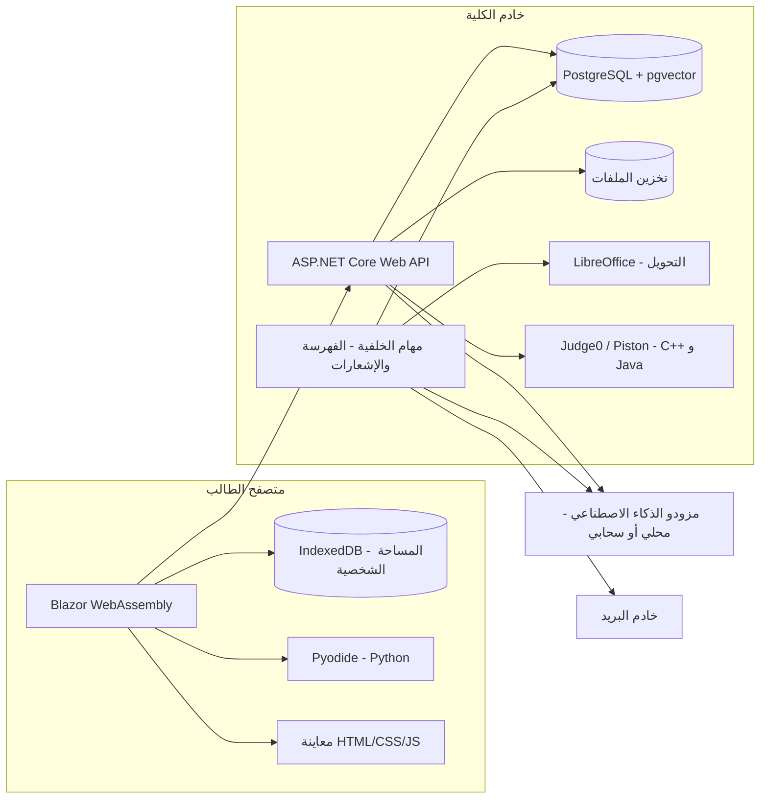

# وثيقة مشروع منصة المحاضرات الجامعية

> **اسم المشروع:** [لم يُحدد بعد]
> **الإصدار:** 1.0 (مسودة أولى، مُحدَّثة بتفاصيل التنفيذ الفعلي الكاملة للقسم 14.1 بتاريخ 31 أكتوبر 2026)
> **التاريخ:** 31 أكتوبر 2026
> **الحالة:** قيد المراجعة من الفريق
> **ملاحظة:** النقاط التي لم تُحسم بعد موثّقة في ملف مستقل: `open-questions-ar.md`

---

## جدول المحتويات

1. [نظرة عامة](#1-نظرة-عامة)
2. [المستخدمون والأدوار والصلاحيات](#2-المستخدمون-والأدوار-والصلاحيات)
3. [الحسابات والتسجيل](#3-الحسابات-والتسجيل)
4. [الهيكل الأكاديمي الديناميكي](#4-الهيكل-الأكاديمي-الديناميكي)
5. [المحاضرات والملفات](#5-المحاضرات-والملفات)
6. [المساحة الشخصية للطالب](#6-المساحة-الشخصية-للطالب)
7. [الذكاء الاصطناعي](#7-الذكاء-الاصطناعي)
8. [محرر الأكواد](#8-محرر-الأكواد)
9. [الأخبار والإشعارات](#9-الأخبار-والإشعارات)
10. [لوحة التحكم](#10-لوحة-التحكم)
11. [الواجهة والتصميم](#11-الواجهة-والتصميم)
12. [المتطلبات غير الوظيفية](#12-المتطلبات-غير-الوظيفية)
13. [البنية التقنية](#13-البنية-التقنية)
14. [نموذج البيانات المبدئي](#14-نموذج-البيانات-المبدئي)
15. [خطة التنفيذ](#15-خطة-التنفيذ)
16. [مسرد المصطلحات](#16-مسرد-المصطلحات)

---

## 1. نظرة عامة

### 1.1 الفكرة
منصة ويب لنشر المحاضرات الجامعية، منظّمة حسب الهيكل الأكاديمي للكلية: الأقسام، ثم المراحل، ثم المواد، ثم المحاضرات. تدمج المنصة الذكاء الاصطناعي لمساعدة الطالب على فهم المحاضرات وترجمتها، وإنشاء التقارير والعروض التقديمية، والتدرّب بالامتحانات، وكتابة الأكواد وتشغيلها في محرر مدمج.

### 1.2 الأهداف
- **مكان واحد** لكل محاضرات الكلية، منظّم ويسهل الوصول إليه.
- **مساعد ذكي مرتبط بالمحاضرة نفسها**، يجيب من محتواها ويوضح بصراحة متى تكون الإجابة من خارجها.
- **بيئة برمجية مدمجة** تناسب طلبة تقنية المعلومات.
- **حل مجاني** قدر الإمكان من ناحية البرمجيات والخدمات.

### 1.3 الفئة المستهدفة
- **حالياً:** طلبة كلية تقنية المعلومات، الدراستان الصباحية والمسائية (قرابة 2000 طالب).
- **مستقبلاً:** كليات أخرى.

### 1.4 طبيعة المشروع
- منتج حقيقي سيُطلق للطلاب، وليس نموذجاً تجريبياً.
- يطوّره فريق من 4 أعضاء (قابل للزيادة).
- لا يوجد موعد نهائي، والمطلوب إنجازه بأسرع وقت ممكن.
- الاستضافة توفرها الكلية.

### 1.5 المبادئ الحاكمة
هذه المبادئ تنطبق على كل قرار بالمشروع:

| المبدأ | المعنى |
|---|---|
| **الديناميكية الكاملة** | لا شيء مثبت بالكود: الكليات والأقسام والمراحل والمواد وحدود الملفات وحدود تشغيل الأكواد ومزودو الذكاء الاصطناعي، كلها تُدار من لوحة التحكم |
| **الجاهزية لعدة كليات** | البنية تدعم أكثر من كلية من اليوم الأول، حتى لو بدأ التشغيل بكلية واحدة |
| **نموذج لكل ميزة** | كل ميزة ذكاء اصطناعي لها مزود ونموذج مستقل يمكن تبديله دون تعديل الكود |
| **البيانات الشخصية في جهاز الطالب** | المحاضرات على الخادم، أما المساحة الشخصية والمحادثات ونتائج الامتحانات فتُخزن بجهاز الطالب |
| **المجانية** | الاعتماد على أدوات مفتوحة المصدر وخدمات مجانية، مع تجنب أي تكاليف اشتراك |

---

## 2. المستخدمون والأدوار والصلاحيات

### 2.1 الأدوار

| الدور | الوصف |
|---|---|
| **الزائر** | يتصفح الهيكل الأكاديمي (الأقسام، المراحل، المواد، عناوين المحاضرات) والأخبار العامة فقط |
| **الطالب** | يفتح المحاضرات ويحمّلها، ويستخدم الذكاء الاصطناعي والمحرر والمساحة الشخصية |
| **المشرف** | يدير المحتوى ضمن نطاق محدد يعيّنه له الأدمن |
| **الأدمن العام** | صلاحيات كاملة على المنصة، وهو الوحيد الذي يعيّن المشرفين |

### 2.2 مستويات الإشراف
كل مستوى يدير ما تحته فقط:

**الأدمن العام ← مشرف كلية ← مشرف قسم ← مشرف مرحلة ← مشرف مادة**

- مشرف القسم مثلاً يدير كل مراحل قسمه وموادها، ولا يرى أقساماً أخرى.
- يمكن أن يكون للمشرف الواحد أكثر من نطاق (مثلاً مشرف على مادتين بمرحلتين مختلفتين).

### 2.3 أنواع الصلاحيات
يحدد الأدمن لكل مشرف، ضمن نطاقه، أياً من الصلاحيات التالية:

| الصلاحية | الوصف |
|---|---|
| **رفع** | إضافة محاضرات وملفات جديدة |
| **تعديل** | تعديل بيانات المحاضرات واستبدال ملفاتها |
| **حذف** | حذف المحاضرات والملفات |
| **نشر أخبار** | نشر أخبار موجهة لنطاقه فقط |
| **إدارة الهيكل** | إضافة مراحل أو مواد ضمن نطاقه (اختيارية) |
| **معالجة البلاغات** | استلام بلاغات الطلاب عن الأخطاء بنطاقه |

### 2.4 قواعد الصلاحيات
- **الأدمن العام فقط** يعيّن المشرفين ويحدد نطاقاتهم وصلاحياتهم. المشرف لا يستطيع تعيين مشرفين آخرين.
- **التحقق من الهوية إلزامي** للمشرفين والأدمن: تسجيل دخول مع **مصادقة ثنائية (2FA)**.
- **سجل نشاط** يوثّق كل إجراء يقوم به المشرفون (انظر 10.4).

---

## 3. الحسابات والتسجيل

### 3.1 طريقة التسجيل (محسوم)
التسجيل يتم عبر **ASP.NET Core Identity** على خطوتين منفصلتين:

1. **تسجيل أساسي:** يسجّل الطالب بأي بريد إلكتروني وكلمة مرور من اختياره، بشرط أن تكون كلمة المرور **مزيجاً من الحروف والأرقام والرموز** (سياسة تعقيد قياسية). هذا التسجيل كافٍ لفتح المحاضرات وتحميلها.
2. **تحقق إضافي لفتح الذكاء الاصطناعي:** يُدخل الطالب بريده الجامعي، فيُرسَل إليه **رمز تحقق (OTP)**. بعد إدخاله بنجاح تُفعَّل ميزات الذكاء الاصطناعي كاملة (المحادثة، الشرح، الترجمة، الامتحانات، التقارير، العروض، تشغيل الأكواد).

> **حالة التنفيذ (31 أكتوبر 2026):** بنية الجداول (Users وكل ما يتبعه) مكتملة فعلياً. منطق خطوتي التسجيل، إرسال/تحقق OTP، وربط JWT الفعلي **لم يُبنَ بعد** — تفاصيل القرارات البنيوية بالقسم 14.1.2.

**القواعد المرتبطة:**
- **الزائر غير المسجَّل:** يتصفح الهيكل والأخبار العامة فقط (دون فتح أو تحميل المحاضرات).
- **قيد تفرّد على البريد الجامعي الموثَّق:** لا يمكن توثيق أكثر من حساب بنفس البريد الجامعي. هذا وحده يحل عملياً مشكلة تعدد الحسابات واستهلاك الذكاء الاصطناعي المضاعف، دون الحاجة لحد استخدام صارم من اليوم الأول.
- **حماية أداء اختيارية:** تبقى لوحة التحكم قادرة على ضبط حد استخدام يومي لكل ميزة إذا احتاج الخادم لذلك مستقبلاً، كإجراء لحماية الأداء وليس لمنع الغش (المشكلة الأخيرة محلولة أصلاً بقيد التفرّد أعلاه).
- خادم البريد الذي يرسل رمز التحقق هو نفسه خادم الإشعارات، وتفاصيله بـ `open-questions-ar.md`.

### 3.2 المرحلة الأساسية وتصفح المراحل
- يحدد الطالب **مرحلته الأساسية** عند التسجيل، فتظهر موادها بصفحته الرئيسية مباشرة.
- يستطيع **تصفح كل المراحل** واستخدام الذكاء الاصطناعي على أي محاضرة.
- يستطيع **إضافة مواد من مراحل أخرى** لصفحته الرئيسية، مثلاً للمواد المحمّلة من مرحلة سابقة.
- يستطيع تغيير مرحلته الأساسية لاحقاً (عند الانتقال لمرحلة جديدة).

### 3.3 عند التسجيل
- يظهر **إشعار خصوصية** يوضح أن محتوى المحاضرات والأسئلة قد يُعالج عبر مزودي ذكاء اصطناعي خارجيين، دون إرسال أي بيانات شخصية.
- يختار الطالب **تفضيلات الإشعارات** (انظر القسم 9).

---

## 4. الهيكل الأكاديمي الديناميكي

### 4.1 التسلسل

**الكلية ← القسم ← المرحلة ← المادة ← المحاضرة**

### 4.2 القواعد
- **كل المستويات تُدار ديناميكياً** من لوحة التحكم: إضافة، تعديل، إعادة ترتيب، إخفاء.
- **المواد يضيفها الأدمن** (أو المشرف المخوّل بصلاحية إدارة الهيكل ضمن نطاقه).
- **عند تحديث قسم أو مادة** (تغيير اسم، دمج، إضافة جديد) يتم ذلك من اللوحة دون أي تعديل برمجي.
- **مقترح:** استخدام **الإخفاء أو الأرشفة** بدل الحذف النهائي للأقسام والمواد، حتى لا تضيع المحاضرات المرتبطة بها. **(محسوم ومُنفَّذ فعلياً — انظر 14.1.1: عمود `Status` بدل أي حذف.)**
- **مواد مشتركة بين عدة مراحل (محسوم):** توجد مادة أو مادتان مشتركتان فعلياً. النظام يدعم ربط المادة الواحدة بأكثر من مرحلة عبر جدول ربط (`SubjectStageLinks`)، فتُرفع محاضراتها مرة واحدة وتظهر تلقائياً بكل المراحل المرتبطة، دون تكرار الرفع. **توسيع محسوم أثناء التنفيذ:** يجوز أن تكون المرحلة الإضافية تابعة لقسم مختلف تماماً عن قسم المرحلة المالكة (مادة عامة تُدرَّس بأكثر من قسم).
- **الدراسة الصباحية والمسائية (محسوم):** المحاضرات مشتركة افتراضياً بين الدراستين. إذا اختلف محتوى محاضرة معينة بينهما، تُرفع نسخة إضافية ويُوسَم كل إصدار بوسم "صباحي" أو "مسائي"، دون إضافة مستوى جديد للهيكل.

---

## 5. المحاضرات والملفات

### 5.1 رفع المحاضرات
- يرفعها الأدمن والمشرفون حسب صلاحياتهم ونطاقهم.
- **المحاضرة الواحدة يمكن أن تحتوي أكثر من ملف.**
- بيانات المحاضرة: العنوان، الوصف، رقم أو ترتيب المحاضرة، المادة التابعة لها، الملفات المرفقة، تاريخ الرفع، اسم الرافع، ونوع البرنامج (مشترك افتراضياً، أو صباحي/مسائي عند الاختلاف).
- **كل صيغ الملفات مسموحة للرفع والتحميل.**

### 5.2 العرض داخل الموقع
- **صيغ تُعرض داخل الموقع:** PDF، Word، PowerPoint، الصور، الملفات النصية، ملفات الأكواد.
- **باقي الصيغ:** تُحمّل فقط ولا تُعرض.

### 5.3 تحويل الصيغ
- **تحويل تلقائي** إلى PDF عند رفع ملفات Word وPowerPoint وما يشابهها، باستخدام LibreOffice على الخادم (مجاني ومفتوح المصدر).
- **زر تحويل يدوي** للحالات التي لا يقبل فيها الذكاء الاصطناعي صيغة الملف.
- يُحتفظ بالملف الأصلي دائماً إلى جانب النسخة المحوّلة.

### 5.4 الفيديو
- رفع ملفات الفيديو مباشرة ضمن الحد المسموح.
- **دعم روابط YouTube غير المدرجة (Unlisted)** كبديل للرفع، لتخفيف الضغط على مساحة الخادم وسرعة الشبكة.

### 5.5 حدود الأحجام
القيم التالية افتراضية، **وتُعدّل من لوحة التحكم**:

| النوع | الحد الافتراضي |
|---|---|
| مستندات (PDF، Word، PowerPoint) | 100 ميغابايت |
| صور | 20 ميغابايت |
| ملفات مضغوطة وصيغ أخرى | 200 ميغابايت |
| فيديو | 1 غيغابايت |
| ملفات المساحة الشخصية | بلا حد من الخادم (تُخزن بجهاز الطالب) |

### 5.6 التحميل (محسوم)
- **التحميل مسموح دائماً** لكل الطلاب المسجلين، على كل المحاضرات، بلا استثناء وبلا خيار لتعطيله.
- لا يوجد بالنظام خيار "عرض فقط". إذا رفض أستاذ مبدأ إتاحة التحميل، فالحل هو **عدم نشر محاضراته على المنصة أصلاً**، لا نشرها مقيّدة.

### 5.7 الفهرسة للذكاء الاصطناعي
- عند رفع أي محاضرة، يُستخرج نصها **تلقائياً بالخلفية** ويُفهرس ليصبح قابلاً للبحث الدلالي (انظر 7.2).
- عند تعديل ملف أو حذفه، تُحدّث الفهرسة تلقائياً.

### 5.8 الإبلاغ عن الأخطاء
- يستطيع الطالب الإبلاغ عن خطأ بمحاضرة أو ملف تالف أو ناقص.
- يصل البلاغ إلى **المشرف المسؤول عن نطاق المحاضرة**، ويتابع حالته (جديد، قيد المعالجة، تم الحل).

---

## 6. المساحة الشخصية للطالب

### 6.1 المفهوم
لكل طالب مساحة خاصة لا يراها غيره، **يُنشئ فيها أقسامه بنفسه حسب ذوقه** (مثل: ملخصات، ملاحظات، تقارير، أو أي تسمية يختارها).

### 6.2 المحتوى المسموح
- **ملاحظات** يكتبها بمحرر نصوص منسّق.
- **ملفات** يرفعها من جهازه.
- **مخرجات الذكاء الاصطناعي** (تقرير، شرح، امتحان، كود) تُحفظ مباشرة بأحد أقسامه.
- **نسخ محاضرة** من الموقع لأحد أقسامه.
- **أكواد** محفوظة من المحرر.

### 6.3 التخزين
- **كل محتوى المساحة الشخصية يُخزن بجهاز الطالب** (داخل المتصفح عبر IndexedDB)، وليس على الخادم.
- يستطيع الطالب **تحميل أي ملف** من مساحته لجهازه.

### 6.4 النسخ الاحتياطي
- **تصدير نسخة احتياطية** كاملة بملف يُحفظ بجهاز الطالب (وليس على الخادم).
- **استيراد النسخة** على أي جهاز أو متصفح آخر.
- **تذكير دوري** للطالب بعمل نسخة احتياطية.
- **تنبيه واضح** للطالب بأن مسح بيانات المتصفح أو تغيير الجهاز دون نسخة احتياطية يعني فقدان المساحة الشخصية.

---

## 7. الذكاء الاصطناعي

### 7.1 مبدأ "نموذج لكل ميزة"
- كل ميزة لها **مزود ونموذج مستقل** يُضبط من لوحة التحكم: الإجابة من المحاضرة، الشرح، الترجمة، الامتحانات، تصحيح الامتحانات، التقارير، العروض التقديمية، الأكواد.
- يُبنى ذلك عبر **واجهة موحّدة** بالكود (`Microsoft.Extensions.AI`)، وتحتها محوّلات لكل مزود: نماذج محلية (مثل Ollama)، خدمات سحابية بطبقة مجانية، أو أي نموذج يُدرَّب لاحقاً.
- **الهدف:** اختيار أفضل نموذج مجاني متخصص لكل مهمة، بدل البحث عن نموذج واحد يلبي كل الاحتياجات.
- **شرط اختيار أي نموذج:** اختبار جودة العربية فيه قبل اعتماده.
- **اقتراحات أولية غير نهائية** لأنسب النماذج المجانية لكل ميزة موثّقة بـ`open-questions-ar.md`، وهي مطروحة للنقاش لا للاعتماد المباشر.

### 7.2 الإجابة من المحاضرة (RAG)
المنصة **لا تدرّب نموذجاً** بالإصدار الأول، بل تعتمد على تقنية الاسترجاع المعزّز (RAG):

1. **استخراج النص** من المحاضرة عند الرفع.
2. **تقسيم النص** لمقاطع صغيرة.
3. **تحويل المقاطع لمتجهات** باستخدام نموذج تضمين مفتوح المصدر يدعم العربية والإنجليزية، ويعمل على المعالج العادي دون بطاقة رسوميات.
4. **تخزين المتجهات** بـPostgreSQL عبر إضافة pgvector. **(الإضافة مفعَّلة فعلياً بقاعدة بيانات التطوير منذ 31 أكتوبر 2026؛ جدول `LectureChunks` نفسه ما زال مؤجلاً للمرحلة 2 لحين حسم نموذج التضمين — السؤال المفتوح رقم 3.)**
5. **عند سؤال الطالب:** يُبحث عن أقرب المقاطع للسؤال، وتُرسل مع السؤال للنموذج اللغوي ليصيغ الإجابة منها.

**لماذا RAG وليس التدريب؟**
- المحاضرات تُضاف باستمرار، وRAG يفهرسها فوراً دون إعادة تدريب.
- RAG يعرف مصدر الإجابة، وهذا شرط أساسي لتنبيه "الإجابة غير موجودة بالمحاضرة".
- لا يحتاج بطاقة رسوميات بجزئي الفهرسة والبحث.

### 7.3 المحادثة مع المحاضرة
- **لكل محاضرة محادثة مستقلة.**
- الإجابة تكون **من محتوى المحاضرة** أولاً.
- **إذا كانت الإجابة غير موجودة بالمحاضرة:** يظهر تنبيه **بخط عريض** يوضح ذلك، ثم يجيب الذكاء الاصطناعي **مباشرة** دون انتظار موافقة الطالب.
- **تمييز بصري** للإجابات من خارج المحاضرة (لون أو أيقونة مختلفة).
- **سجل المحادثات يُخزن بجهاز الطالب.**

### 7.4 شرح المحاضرة
- **مستويات الشرح:** مبسّط، مفصّل، مع أمثلة، "كأني مبتدئ".
- **شرح جزء محدد:** يحدد الطالب فقرة أو جزءاً من المحاضرة ويطلب شرحه فقط.

### 7.5 الترجمة
- **عربي ↔ إنجليزي** بالاتجاهين.
- ترجمة المحاضرة كاملة أو جزء محدد منها.
- الحفاظ على المصطلحات التقنية والأكواد كما هي.

### 7.6 الامتحانات
- **للتدريب الذاتي فقط.**
- **نطاق الامتحان يختاره الطالب:** محاضرة واحدة، أو عدة محاضرات، أو مادة كاملة.
- **يختار الطالب** عدد الأسئلة ومستوى الصعوبة.
- **كل أنواع الأسئلة مدعومة**، ومنها: اختيار من متعدد، اختيار متعدد الإجابات، صح وخطأ، ملء الفراغ، إجابة قصيرة، مقالي، مطابقة، ترتيب، كتابة كود، توقّع مخرجات كود، اكتشاف الخطأ بكود.
- **الذكاء الاصطناعي هو من يصحح**، ويعطي ملاحظات على الإجابات المقالية والبرمجية.
- **بدون مؤقت زمني.**
- **سجل للنتائج** يُخزن بجهاز الطالب.

### 7.7 التقارير
- **الطالب يحدد** بطلبه للنموذج الصيغة التي يريدها: Word أو PDF أو PowerPoint مبدئياً.
- **بدون قوالب إلزامية.**
- **يُسمح بمعلومات من خارج المحاضرة**، مع تنبيه واضح عليها.
- الملف الناتج يُحمّل أو يُحفظ بالمساحة الشخصية.

### 7.8 العروض التقديمية
- **صيغة PowerPoint قابلة للتعديل.**
- **الطالب يطلب ما يريد** (عدد الشرائح، الأسلوب، المحتوى) والنموذج ينفذ.
- **الحد الأقصى 20 شريحة.** إذا طلب الطالب أكثر، يُلتزم بالحد ويُبلّغ الطالب بذلك.

### 7.9 توليد الأكواد
- **الكود يبقى بالمحادثة**، ولا يُفتح بالمحرر تلقائياً.
- **زر أسفل كل كود** لفتحه وتشغيله بالمحرر.
- **الذكاء الاصطناعي لا يشرح الكود** إلا إذا طلب الطالب ذلك صراحة.
- **المساعدة بتصحيح الأخطاء** عند فشل التشغيل، بطلب من الطالب.

### 7.10 الخصوصية بالذكاء الاصطناعي
- **لا تُرسل أي بيانات شخصية** للنماذج (الاسم، البريد، الرقم الجامعي)، فقط نص المحاضرة والسؤال.
- **تنبيه للطالب** قبل إرسال ملف من مساحته الشخصية للذكاء الاصطناعي.
- **خيار "نموذج محلي فقط"** لكل ميزة بلوحة التحكم.
- **الخادم يسجّل إحصائيات الاستخدام فقط** (عدد الطلبات لكل ميزة) دون محتوى المحادثات.

---

## 8. محرر الأكواد

### 8.1 المحرر
- مبني على **Monaco** (نفس محرر VS Code)، مع تلوين الأكواد والإكمال التلقائي الأساسي.
- **اللغات المبدئية:** Python، Java، JavaScript، HTML، CSS، C++.

### 8.2 التشغيل

| اللغة | مكان التشغيل | التقنية |
|---|---|---|
| HTML / CSS / JavaScript | المتصفح | إطار معزول (Sandboxed iframe) مع معاينة حية |
| Python | المتصفح | Pyodide |
| C++ / Java | الخادم | Judge0 أو Piston، مستضاف ذاتياً داخل حاويات Docker معزولة |

### 8.3 إدخال المستخدم
- **الإصدار الأول:** صندوق إدخال يملؤه الطالب **قبل التشغيل**، ويقرأ البرنامج منه (مثل `input()` و`cin`).
- **لاحقاً (اختياري):** طرفية تفاعلية حقيقية عبر اتصال مستمر.

### 8.4 تعدد الملفات

| النوع | الإصدار الأول | الإصدار اللاحق |
|---|---|---|
| HTML / CSS / JavaScript | ثلاث تبويبات مرتبطة مع معاينة حية | دعم ملفات إضافية وصور |
| Python / C++ / Java | ملف واحد | مشروع بشجرة ملفات (حتى 10 ملفات مبدئياً) |

### 8.5 حدود التشغيل
القيم التالية افتراضية، **وتُعدّل من لوحة التحكم**:

| الحد | القيمة الافتراضية |
|---|---|
| وقت الترجمة (Compile) | 15 ثانية |
| وقت التشغيل | 5 ثوانٍ |
| الذاكرة | 256 ميغابايت |
| حجم المخرجات | محدود (يُضبط من اللوحة) |

### 8.6 الحفظ
- **حفظ الأكواد بالمساحة الشخصية** للطالب.
- تحميل الكود كملف للجهاز.

---

## 9. الأخبار والإشعارات

### 9.1 قسم الأخبار
- **إعلانات أكاديمية للكلية** وليس أخباراً عامة: جداول الامتحانات، العطل، تأجيل محاضرة، إضافة مادة جديدة، وما يشابهها.
- **ينشرها كل مشرف حسب صلاحيته ونطاقه** (مشرف القسم ينشر لقسمه فقط)، والأدمن ينشر للجميع.
- **توجيه الخبر لفئة محددة:** الكلية كلها، قسم، مرحلة، أو مادة.
- الأخبار الموجهة للكلية كلها **تظهر للزوار** أيضاً.
- **تنفيذ فعلي (31 أكتوبر 2026):** عنوان الخبر ومحتواه **حقل حر بلغة واحدة** يختارها الناشر، لا ثنائي اللغة مثل الهيكل الأكاديمي — قرار مقصود لتفادي إبطاء نشر إعلان عاجل بفرض كتابته بلغتين (التفاصيل بالقسم 14.1.2).

### 9.2 الإشعارات التلقائية
- **إشعار عند رفع محاضرة جديدة** بمواد الطالب (مواد مرحلته الأساسية والمواد التي أضافها).
- **إشعار عند نشر خبر** موجّه لفئة الطالب.
- **تنفيذ فعلي:** كل إشعار يحمل ربطاً اختيارياً بالعنصر المصدر (محاضرة أو خبر)، ليكون قابلاً للضغط والانتقال المباشر — إضافة فوق المواصفة الأصلية.

### 9.3 قنوات الإشعار
- **البريد الإلكتروني.**
- **جرس إشعارات داخل الموقع** (بلا تكلفة ولا حدود).

### 9.4 تفضيلات الطالب
- يختار ما يصله بالبريد: الأخبار فقط، المحاضرات فقط، الكل، أو لا شيء.
- **خيار الملخص اليومي:** رسالة واحدة تجمع كل جديد اليوم بدل عدة رسائل.

### 9.5 خادم البريد
- يُفضّل أن توفره الكلية، لأن خدمات الإرسال المجانية لها حدود يومية.

---

## 10. لوحة التحكم

### 10.1 إدارة الهيكل والمحتوى
- إدارة الكليات والأقسام والمراحل والمواد والمحاضرات.
- ربط مادة بأكثر من مرحلة (للمواد المشتركة).

### 10.2 إدارة المستخدمين والصلاحيات
- تعيين المشرفين وتحديد نطاقاتهم وصلاحياتهم (للأدمن العام فقط).
- إدارة حسابات الطلاب (تعطيل، تفعيل).

### 10.3 إعدادات الذكاء الاصطناعي
- اختيار المزود والنموذج لكل ميزة.
- تفعيل خيار "نموذج محلي فقط" لأي ميزة.
- اختبار الاتصال بالمزود.

### 10.4 سجل النشاط
- يوثق كل إجراء للمشرفين والأدمن: من رفع، من عدّل، من حذف، ومتى، وعلى أي عنصر.

### 10.5 الإحصائيات
- المحاضرات الأكثر مشاهدة وتحميلاً.
- استخدام الذكاء الاصطناعي لكل ميزة.
- عدد المستخدمين النشطين.

### 10.6 البلاغات
- صندوق بلاغات الطلاب، يظهر لكل مشرف حسب نطاقه.

### 10.7 إعدادات النظام
- حدود أحجام الملفات.
- حدود تشغيل الأكواد.
- إعدادات البريد والإشعارات.

---

## 11. الواجهة والتصميم

- **اللغة:** عربية وإنجليزية مع زر للتبديل، والاتجاه يتغير تلقائياً (RTL للعربية، LTR للإنجليزية).
- **السمة:** فاتح، داكن، وتلقائي حسب إعدادات المتصفح.
- **الموبايل:** تصميم متجاوب بالكامل، وهو **مطلب أساسي**.
- **تطبيق قابل للتثبيت (PWA)** على الهاتف والحاسوب.
- **الهوية البصرية:** لا توجد هوية رسمية للكلية يُلتزم بها، وسيُصمم للمنصة هوية خاصة بها.

---

## 12. المتطلبات غير الوظيفية

### 12.1 الأمان
- اتصال مشفّر (HTTPS) إلزامي.
- مصادقة ثنائية للمشرفين والأدمن.
- تحقق من الصلاحيات **على مستوى الخادم** لكل طلب، وليس بالواجهة فقط.
- تشغيل أكواد C++ وJava بحاويات معزولة بلا وصول للشبكة أو لملفات الخادم.
- فحص الملفات المرفوعة (النوع والحجم).
- **مشروع Web (Blazor WebAssembly) لا يشير إلا إلى Shared**، ولا يحتوي أي سلسلة اتصال أو مفتاح سري مباشرة — لأن كود WASM يُشحَن كاملاً لمتصفح الطالب، فأي شيء يشير إليه المشروع يصبح قابلاً للتنزيل من أي شخص.

### 12.2 الخصوصية
- البيانات الشخصية للطالب (المساحة، المحادثات، النتائج) بجهازه.
- لا تُرسل بيانات شخصية لمزودي الذكاء الاصطناعي.
- إشعار خصوصية واضح عند التسجيل.

### 12.3 الأداء والسعة
- خدمة قرابة **2000 طالب**.
- **تقدير أولي للخادم** (بدون نموذج لغوي محلي): معالج 8 أنوية، ذاكرة 16 إلى 32 غيغابايت، تخزين SSD من 500 غيغابايت إلى 1 تيرابايت. يُراجع بعد الاختبار الفعلي.
- تشغيل نموذج لغوي محلي بسرعة مقبولة يحتاج بطاقة رسوميات منفصلة.
- الفهرسة وتحويل الملفات وإرسال البريد تتم **بالخلفية** دون إبطاء الموقع.

### 12.4 قابلية التوسع
- البنية جاهزة لإضافة كليات أخرى.
- فصل الخادم عن الواجهة يسمح ببناء تطبيق موبايل لاحقاً يستخدم نفس الـ API.

---

## 13. البنية التقنية

### 13.1 التقنيات المعتمدة

| الطبقة | التقنية |
|---|---|
| الواجهة الخلفية | ASP.NET Core Web API على .NET 10 (LTS) |
| الواجهة الأمامية | Blazor WebAssembly |
| قاعدة البيانات | PostgreSQL مع إضافة pgvector |
| الوصول للبيانات | Entity Framework Core (مزود Npgsql) + `EFCore.NamingConventions` لتسمية `snake_case` |
| الحسابات | ASP.NET Core Identity مع المصادقة الثنائية — **بنية الجداول مكتملة، منطق التسجيل/الدخول الفعلي لاحق** |
| تخزين الملفات | مساحة على الخادم خارج قاعدة البيانات |
| تحويل الملفات | LibreOffice (وضع بدون واجهة) |
| الذكاء الاصطناعي | `Microsoft.Extensions.AI` كواجهة موحدة + Ollama للنماذج المحلية + مزودون سحابيون |
| محرر الأكواد | Monaco |
| تشغيل Python | Pyodide (بالمتصفح) |
| تشغيل C++ وJava | Judge0 أو Piston (مستضاف ذاتياً بـDocker) |
| التخزين المحلي | IndexedDB |
| توليد ملفات Office | Open XML SDK، مع LibreOffice للتحويل لـPDF |
| المصادقة بين Blazor WASM وAPI | **JWT (Bearer Token)** — قرار محسوم، الحزمة مُضافة، الربط الفعلي لاحق |

**نمط البنية المعماري (محسوم):** يعتمد المشروع **Clean Architecture** بترتيب اعتمادية صارم: Domain لا يعتمد على أي طبقة أخرى (ولا حتى على ASP.NET Core Identity — `ApplicationUser` يعيش حصراً بطبقة Infrastructure)، Application يعتمد على Domain فقط (ويحمل تجريد `IAppDbContext` بدون أي إشارة لـNpgsql أو Identity)، Infrastructure تنفّذ الواجهات المعرَّفة بApplication (وتحمل `AppDbContext` الفعلي الموروث من `IdentityDbContext`)، وAPI وWeb (Blazor) طبقتان خارجيتان لا تعتمد إحداهما على الأخرى. التجريد الكامل محجوز لما يحتاجه فعلاً تبديلاً — لا لعمليات CRUD البسيطة (**مُطبَّق فعلياً**: لا Repository منفصل لكل كيان، فقط `IEntityTypeConfiguration` لكل كيان مع `DbSet` مباشر عبر `IAppDbContext`).

### 13.2 استراتيجية النشر وبيئة التطوير (محسوم)
- **مرحلة التطوير والاختبار:** يُنشر المشروع على **استضافة مجانية** تدعم حاويات .NET وPostgreSQL مع pgvector (مثل Render أو Railway أو Fly.io للتطبيق، وSupabase أو Neon لقاعدة البيانات)، ريثما يُبنى المشروع ويُختبر.
- **مرحلة الإنتاج:** يُنقَل المشروع لـ**خادم الكلية** بعد تجهيزه وتوفر مواصفاته (انظر `open-questions-ar.md`).
- **شرط أساسي:** كل الإعدادات (سلسلة الاتصال بقاعدة البيانات، مفاتيح الذكاء الاصطناعي، المسارات) تُضبط عبر متغيرات البيئة فقط، دون أي قيمة مثبتة بالكود، لضمان انتقال سلس بين الاستضافتين.
- **بيئة التطوير المحلية عبر Docker:** تُشغَّل عبر ملف `docker-compose.yml` واحد يشاركه الفريق: PostgreSQL+pgvector (منفذ الاستضافة **5433** لا 5432 — لتفادي تعارض محتمل مع أي تثبيت PostgreSQL مباشر على وندوز، راجع `project-status.md` قسم 7.1)، خادم تنفيذ الأكواد (Judge0 أو Piston — إلزامي أصلاً)، LibreOffice، وخادم بريد تجريبي محلي (مثل Mailpit).
- **الـ API وواجهة Blazor تُشغَّلان مباشرة** على جهاز كل مطوّر (`dotnet watch`) وليس داخل حاوية.
- **`Dockerfile` لمشروع الـ API يُكتب من بداية المرحلة الأولى**، لا قبل النشر مباشرة.
- **ملف `.env` يجب أن يُحفظ بنهايات أسطر LF لا CRLF** — Docker Compose يقرأ هذا الملف بطريقة لينكس، ونهايات وندوز تُدخل حرف `\r` خفياً داخل القيم (مثل كلمة مرور قاعدة البيانات) وتكسر المصادقة بصمت دون رسالة خطأ واضحة.
- **مشروع Infrastructure يحتاج `<FrameworkReference Include="Microsoft.AspNetCore.App" />`** بملف الـ`csproj` الخاص به — `AddIdentity` وأنواع Identity الأساسية تأتي من الإطار المشترك لـASP.NET Core، لا من حزمة NuGet مستقلة، وغير متاحة تلقائياً بمشروع مكتبة عادية (`Microsoft.NET.Sdk`).

### 13.3 مخطط البنية

### 13.4 أين تُخزن البيانات

| البيانات | المكان |
|---|---|
| الهيكل الأكاديمي، المحاضرات، الملفات، الأخبار | الخادم |
| الحسابات والصلاحيات وسجل النشاط | الخادم |
| فهرس المحاضرات للذكاء الاصطناعي | الخادم (pgvector) |
| الإشعارات وتفضيلاتها | الخادم |
| إحصائيات الاستخدام (أعداد فقط) | الخادم |
| المساحة الشخصية وأقسامها | جهاز الطالب |
| سجل المحادثات مع الذكاء الاصطناعي | جهاز الطالب |
| نتائج الامتحانات | جهاز الطالب |
| الأكواد المحفوظة | جهاز الطالب |

---

## 14. نموذج البيانات المبدئي

### 14.1 جداول الخادم

**كل الجداول أدناه ✅ مُنفَّذة فعلياً بقاعدة بيانات التطوير (29 جدولاً، 31 أكتوبر 2026)، ما عدا `LectureChunks` المؤجَّل.**

| الجدول | أهم الحقول | العلاقات |
|---|---|---|
| **Colleges** ✅ | الاسم (عربي وإنجليزي)، الترتيب، الحالة | يحتوي الأقسام |
| **Departments** ✅ | الاسم، الترتيب، الحالة | يتبع كلية، يحتوي مراحل |
| **Stages** ✅ | الاسم، الرقم، الترتيب، الحالة | يتبع قسماً، يرتبط بمواد (مباشرة أو عبر `SubjectStageLinks`) |
| **Subjects** ✅ | الاسم، الوصف، الترتيب، الحالة، المرحلة المالكة | قد ترتبط بأكثر من مرحلة عبر `SubjectStageLinks` (للمواد المشتركة، حتى عبر أقسام مختلفة)، تحتوي محاضرات |
| **SubjectStageLinks** ✅ | — | يربط مادة مشتركة بمرحلة إضافية غير مرحلتها المالكة |
| **Lectures** ✅ (بيانات وصفية فقط) | العنوان، الوصف، الرقم، نوع البرنامج، تاريخ الرفع، الحالة، **من رفعها (`UploadedByUserId`)** | تتبع مادة، تحتوي ملفات |
| **LectureFiles** ✅ | الاسم الأصلي، المسار، الصيغة، الحجم، مسار النسخة المحوّلة، حالة الفهرسة | تتبع محاضرة |
| **LectureVideoLinks** ✅ | الرابط، العنوان | تتبع محاضرة |
| **LectureChunks** ⏸️ مؤجَّل للمرحلة 2 | النص، المتجه (vector)، الترتيب | تتبع ملف محاضرة — ينتظر حسم بُعد المتجه (السؤال المفتوح رقم 3) |
| **Users** ✅ (جدول Identity، أُعيدت تسميته من `AspNetUsers`) | (من ASP.NET Identity) + الاسم، اللغة المفضلة، السمة، البريد الجامعي وتاريخ توثيقه | — |
| **Roles / UserRoles / UserClaims / UserLogins / UserTokens / RoleClaims** ✅ (جداول Identity قياسية، أُعيدت تسميتها) | — | Student/Supervisor/Admin فقط مُستخدَمة حالياً |
| **StudentProfiles** ✅ | المرحلة الأساسية | يتبع مستخدماً (1:1) |
| **StudentPinnedSubjects** ✅ | — | يربط طالباً بمادة إضافية |
| **SupervisorScopes** ✅ | نوع النطاق، معرّف النطاق (4 أعمدة Nullable بقيد CHECK)، 6 صلاحيات Boolean | يتبع مستخدماً |
| **News** ✅ | العنوان، المحتوى (حقل حر بلغة واحدة) | ناشره مستخدم |
| **NewsTargets** ✅ | نوع الفئة، معرّف الفئة (نفس نمط CHECK) | يتبع خبراً |
| **Notifications** ✅ | النوع، النص، ربط اختياري بالعنصر المصدر، وقت القراءة | تتبع مستخدماً |
| **NotificationPreferences** ✅ | البريد (أخبار/محاضرات/الكل/لا شيء)، الملخص اليومي | تتبع مستخدماً (1:1) |
| **ErrorReports** ✅ | الوصف، الحالة | تتبع محاضرة أو ملفاً وطالباً |
| **ActivityLogs** ✅ | الإجراء، نوع العنصر (بدون مفتاح أجنبي حقيقي — عمداً)، معرّفه، التفاصيل، الوقت | يتبع مستخدماً |
| **AiFeatureSettings** ✅ | الميزة (مفتاح أساسي)، المزود، النموذج، العنوان، "محلي فقط" | — |
| **SystemSettings** ✅ | المفتاح (مفتاح أساسي)، القيمة | — |
| **LectureViewStats** ✅ | عدد المشاهدات والتحميلات | يتبع محاضرة (1:1) |
| **AiUsageStats** ✅ | الميزة، التاريخ (مفتاح مركّب)، العدد | — |

### 14.1.1 تفاصيل التنفيذ الفعلي — الهيكل الأكاديمي (31 أكتوبر 2026)

الجداول الستة الأولى أعلاه مُنفَّذة فعلياً بـEntity Framework Core 10 وطُبِّقت كـMigration حقيقية على قاعدة بيانات تطوير (Postgres بحاوية Docker). القرارات التفصيلية التالية حُسمت أثناء هذا التنفيذ، وتُلزم أي كود لاحق يتعامل مع هذي الجداول:

- **المعرّف الأساسي:** `Guid` (الإصدار 7، مرتّب زمنياً) لكل كيان حقيقي. يُستثنى منه `SubjectStageLinks` فقط (مفتاح مركّب، انظر أدناه).
- **الأسماء ثنائية اللغة:** عمودان `NameAr` (نص، **مطلوب دائماً**) و`NameEn` (نص، **اختياري**) بكل من Colleges, Departments, Stages, Subjects. إذا كان `NameEn` فارغاً، تعرض الواجهة الإنجليزية `NameAr` بدلاً عنه. نفس المبدأ لحقلي `DescriptionAr`/`DescriptionEn` الاختياريين بـSubjects.
- **الحالة بدل الحذف:** عمود `Status` بثلاث قيم (`Visible`/`Hidden`/`Archived`) بكل الجداول الستة — **بما فيها Lectures**، رغم أن المواصفة الأصلية بالقسم 14.1 لم تذكرها صراحة لها. لا حذف فعلي لأي عنصر بالهيكل الأكاديمي من الكود.
- **`SubjectStageLinks`:** جدول ربط صرف بدون `Id` مستقل — مفتاحه الأساسي مركّب `(SubjectId, StageId)`. القاعدة "لا تكون المرحلة الإضافية نفسها المرحلة المالكة" قاعدة تطبيقية (تُفحص بالكود)، وليست قيداً بقاعدة البيانات.
- **فهارس فريدة:** `(DepartmentId, Number)` على Stages، و`(SubjectId, Number, ProgramType)` على Lectures.
- **تسمية قاعدة البيانات:** `snake_case` بالكامل تلقائياً عبر حزمة `EFCore.NamingConventions` (مثال: الجدول `subject_stage_links`، العمود `name_ar`).
- **القيم المعدودة (enum) تُخزَّن كنص** (مثل `"Visible"`, `"Morning"`) لا كرقم، لسهولة القراءة المباشرة من قاعدة البيانات وعدم الكسر عند تغيير ترتيب القيم بالكود.
- **حقول التتبع:** `CreatedAt`/`UpdatedAt` بتوقيت UTC، تُنملى تلقائياً بالكود عند الحفظ (لا تُدخَل يدوياً).
- **pgvector:** الامتداد مفعَّل فعلياً بقاعدة بيانات التطوير (نسخة 0.8.7 مؤكَّدة)، رغم أن جدول `LectureChunks` نفسه ما زال مؤجلاً للمرحلة 2 حسب الخطة الأصلية.

### 14.1.2 تفاصيل التنفيذ الفعلي — Identity وكل الجداول المتبقية (31 أكتوبر 2026)

**قرارات بنيوية حاكمة:**
- **`ApplicationUser : IdentityUser<Guid>` يعيش بطبقة Infrastructure حصراً.** Domain لا يشير له إطلاقاً (لا حتى بصنف منفصل) — كيانات Domain الأخرى (`StudentProfile`, `Lecture.UploadedByUserId`...) تخزّن `Guid UserId` عادي بدون أي علم بالصنف الفعلي، والـConfigurations بطبقة Infrastructure هي من تربط المفتاح الأجنبي فعلياً بقاعدة البيانات (`HasOne<ApplicationUser>()` بدون Navigation Property على الجهتين).
- **أدوار Identity القياسية** (`Student`, `Supervisor`, `Admin`) للتصنيف الخشن فقط عبر جداول `AspNetRoles`/`AspNetUserRoles` (أُعيدت تسميتها لـ`roles`/`user_roles`). التفاصيل الدقيقة (أي نطاق، أي صلاحية) بجدول `SupervisorScopes` المخصَّص فقط.
- **حقول إضافية على `Users`:** `DisplayName`, `PreferredLanguage` (Arabic/English)، `Theme` (Light/Dark/Auto)، `UniversityEmail` (فاضٍ حتى يُوثَّق)، `UniversityEmailVerifiedAt` (فاضٍ = غير موثَّق، تاريخ فعلي = وقت نجاح OTP).
- **المصادقة:** **JWT** لا Cookie (يناسب Blazor WASM منفصل عن API). الحزمة (`Microsoft.AspNetCore.Authentication.JwtBearer`) مُضافة، **الربط الفعلي بـ`Program.cs` (إصدار/تحقق التوكن) لم يحصل بعد.**
- **2FA** تُبنى على آلية Identity القياسية جاهزة (`TwoFactorEnabled`)، تفعيلها الإلزامي للمشرف/الأدمن منطق تطبيقي يُبنى بخطوة التسجيل القادمة.

**تصميم `SupervisorScopes` و`NewsTargets` (النطاق متعدد الأنواع):**
بدل عمود واحد `ScopeId` بلا قيد حقيقي، استُخدمت 4 أعمدة Nullable (`CollegeId/DepartmentId/StageId/SubjectId`) + **قيد `CHECK` بـPostgreSQL** (`num_nonnulls(...) = 1`) يضمن تعبئة واحد بالضبط منها. **تصحيح تصميمي اكتُشف أثناء البناء:** فهرس فريد مركّب واحد على الأعمدة الأربعة **لا يمنع التكرار فعلياً** لأن Postgres يعتبر كل قيمة `NULL` مختلفة عن أي `NULL` أخرى حتى بقيود التفرّد. الحل الصحيح المُطبَّق: **4 فهارس فريدة جزئية (Partial Unique Index)** منفصلة، كل واحد مفلتَر بـ`WHERE scope_type = '...'` — مؤكَّد فعلياً بفحص مباشر لبنية الجدول بعد التطبيق.

**استثناءان مقصودان من نمط "مفتاح أجنبي حقيقي":**
- `ActivityLog.EntityId` بدون قيد — أنواع العناصر المحتملة كثيرة ومفتوحة (محاضرة، كلية، خبر...)، يختلف عن حالة `SupervisorScope`/`NewsTarget` المحصورة بـ4 أنواع فقط.
- `Notification.RelatedEntityType`/`RelatedEntityId` — نفس السبب، إضافة فوق المواصفة الأصلية لجعل الإشعار قابلاً للضغط والانتقال.

**قرارات تصميم أخرى:**
- `News`: حقل واحد (`Title`/`Content`) لا ثنائي اللغة — محتوى تحريري لحظي يكتبه الناشر بلغة واحدة، بخلاف أسماء الهيكل الأكاديمي الثابتة.
- `AiFeatureSettings`: مفتاحه الأساسي `FeatureKey` نفسه (enum مُخزَّن كنص: Chat/Explanation/Translation/ExamGeneration/ExamGrading/Reports/Presentations/CodeGeneration) — صف ثابت واحد لكل ميزة، بدون `Id` منفصل.
- `SystemSettings`: مفتاح/قيمة عام حر (`Key` نص مفتوح، لا enum) لأنه يغطي إعدادات متنوعة ومفتوحة (حدود الملفات، التشغيل، البريد).
- `LectureViewStats`، `StudentProfiles`، `NotificationPreferences`: علاقات 1:1 حقيقية، بدون `Id` منفصل — نفس نمط `SubjectStageLinks` بالخطوة السابقة.
- **إعادة تسمية جداول Identity:** من بادئة `AspNet*` الافتراضية لأسماء مطابقة لتسمية المواصفة (`users`, `roles`, `user_roles`, `user_claims`, `user_logins`, `user_tokens`, `role_claims`).

**مشكلة بناء صودفت وحُلَّت:** `AddIdentity` غير متاح افتراضياً بمشروع مكتبة عادية — التفاصيل بالقسم 13.2.

**التحقق الفعلي (مؤكَّد):** `dotnet build` ناجح، Migration واحدة (`AddIdentityAndCoreTables`) طُبِّقت، **29 جدولاً** مؤكَّدة بفحص مباشر، وقيد `CHECK` + الفهارس الجزئية الأربعة + المفتاح الأجنبي بـ`supervisor_scopes` مؤكَّدة جميعها بفحص بنية الجدول مباشرة بعد التطبيق.

---

## 15. خطة التنفيذ

| المرحلة | المحتوى |
|---|---|
| **المرحلة 1: الأساس** | الهيكل الديناميكي، الحسابات والصلاحيات والمصادقة الثنائية، رفع المحاضرات وعرضها وتحويلها، المساحة الشخصية والنسخ الاحتياطي، لوحة التحكم الأساسية، سجل النشاط |
| **المرحلة 2: الذكاء الاصطناعي الأساسي** | الواجهة الموحدة للمزودين، فهرسة المحاضرات (RAG)، المحادثة مع المحاضرة، الشرح، الترجمة |
| **المرحلة 3: محرر الأكواد** | المحرر، التشغيل بالمتصفح (HTML/CSS/JS، Python)، خادم تشغيل C++ وJava، حدود التشغيل |
| **المرحلة 4: الذكاء الاصطناعي المتقدم** | الامتحانات وتصحيحها، التقارير، العروض التقديمية، توليد الأكواد مع زر التشغيل |
| **المرحلة 5: الأخبار والإشعارات** | قسم الأخبار، الإشعارات التلقائية، البريد، الملخص اليومي، البلاغات، الإحصائيات |

**مؤجل لما بعد الإصدار الأول:** الطرفية التفاعلية، المشاريع متعددة الملفات للغات غير الويب، تطبيق موبايل أصلي، كليات إضافية.

---

## 16. مسرد المصطلحات

| المصطلح | المعنى |
|---|---|
| **RAG** | الاسترجاع المعزّز: البحث بالمحاضرة عن المقاطع المناسبة ثم إرسالها للنموذج ليجيب منها |
| **Embedding (التضمين)** | تحويل النص لأرقام تمثل معناه، لتسهيل البحث الدلالي |
| **pgvector** | إضافة لـ PostgreSQL تخزن المتجهات وتبحث فيها |
| **Fine-tuning (الضبط)** | إكمال تدريب نموذج جاهز على بيانات خاصة |
| **2FA** | المصادقة الثنائية: خطوة تحقق ثانية بعد كلمة المرور |
| **JWT** | Bearer Token يُصدره الخادم بعد تسجيل الدخول، يثبته الطالب بكل طلب لاحق بدل جلسة Cookie تقليدية |
| **IndexedDB** | قاعدة بيانات داخل المتصفح لتخزين البيانات بجهاز المستخدم |
| **PWA** | تطبيق ويب قابل للتثبيت على الهاتف والحاسوب |
| **Docker** | تقنية حاويات لتشغيل البرامج ببيئة معزولة |
| **Sandbox** | بيئة معزولة تمنع الكود من الوصول لما هو خارجها |
| **LTS** | إصدار بدعم طويل الأمد |

