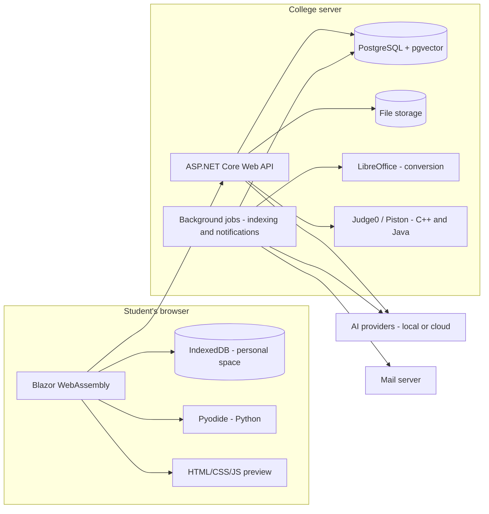

# University Lectures Platform — Project Documentation

> **Project name:** [To be decided]
> **Version:** 1.0 (first draft)
> **Date:** October 31, 2026
> **Status:** Under team review
> **Note:** Undecided items are tracked in a separate file: `open-questions.md`

---

## Table of Contents

1. [Overview](#1-overview)
2. [Users, Roles and Permissions](#2-users-roles-and-permissions)
3. [Accounts and Registration](#3-accounts-and-registration)
4. [Dynamic Academic Structure](#4-dynamic-academic-structure)
5. [Lectures and Files](#5-lectures-and-files)
6. [Student Personal Space](#6-student-personal-space)
7. [Artificial Intelligence](#7-artificial-intelligence)
8. [Code Editor](#8-code-editor)
9. [News and Notifications](#9-news-and-notifications)
10. [Admin Panel](#10-admin-panel)
11. [UI and Design](#11-ui-and-design)
12. [Non-Functional Requirements](#12-non-functional-requirements)
13. [Technical Architecture](#13-technical-architecture)
14. [Initial Data Model](#14-initial-data-model)
15. [Implementation Plan](#15-implementation-plan)
16. [Glossary](#16-glossary)

---

## 1. Overview

### 1.1 Concept
A web platform for publishing university lectures, organized by the college's academic structure: departments, then stages (academic years), then subjects, then lectures. The platform integrates AI to help students understand and translate lectures, generate reports and presentations, practice with exams, and write and run code in a built-in editor.

### 1.2 Goals
- **One place** for all of the college's lectures, organized and easy to access.
- **An AI assistant tied to the lecture itself**, answering from its content and stating clearly when an answer comes from outside it.
- **A built-in coding environment** suited to IT students.
- **A free solution** wherever possible, in both software and services.

### 1.3 Target Audience
- **Now:** students of the College of Information Technology, morning and evening programs (about 2,000 students).
- **Later:** other colleges.

### 1.4 Project Nature
- A real product to be launched for students, not a prototype.
- Developed by a team of 4 (may grow).
- No hard deadline; the goal is to ship as soon as possible.
- Hosting is provided by the college.

### 1.5 Guiding Principles
These principles apply to every decision in the project:

| Principle | Meaning |
|---|---|
| **Fully dynamic** | Nothing is hard-coded: colleges, departments, stages, subjects, file limits, code execution limits and AI providers are all managed from the admin panel |
| **Multi-college ready** | The architecture supports multiple colleges from day one, even though it launches with one |
| **One model per feature** | Each AI feature has its own provider and model, switchable without code changes |
| **Personal data on the student's device** | Lectures live on the server; the personal space, chats and exam results live on the student's device |
| **Free** | Rely on open-source tools and free services, avoiding any subscription costs |

---

## 2. Users, Roles and Permissions

### 2.1 Roles

| Role | Description |
|---|---|
| **Visitor** | Browses the academic structure (departments, stages, subjects, lecture titles) and public news only |
| **Student** | Opens and downloads lectures; uses AI, the code editor and the personal space |
| **Supervisor** | Manages content within a specific scope assigned by the admin |
| **Super Admin** | Full control over the platform; the only one who can assign supervisors |

### 2.2 Supervision Levels
Each level manages only what is beneath it:

**Super Admin → College Supervisor → Department Supervisor → Stage Supervisor → Subject Supervisor**

- A department supervisor, for example, manages all stages and subjects in that department and cannot see other departments.
- A single supervisor can hold more than one scope (e.g., two subjects in two different stages).

### 2.3 Permission Types
Within a supervisor's scope, the admin grants any of the following:

| Permission | Description |
|---|---|
| **Upload** | Add new lectures and files |
| **Edit** | Edit lecture details and replace files |
| **Delete** | Delete lectures and files |
| **Publish news** | Publish news targeted at their own scope only |
| **Manage structure** | Add stages or subjects within their scope (optional) |
| **Handle reports** | Receive student error reports within their scope |

### 2.4 Permission Rules
- **Only the Super Admin** assigns supervisors and defines their scopes and permissions. Supervisors cannot assign other supervisors.
- **Identity verification is mandatory** for supervisors and admins: sign-in plus **two-factor authentication (2FA)**.
- **An activity log** records every action taken by supervisors (see 10.4).

---

## 3. Accounts and Registration

### 3.1 Registration Method
> ⚠️ **Not decided yet.** Details in `open-questions.md`.

**Preferred proposal:** Sign in with Google or Microsoft, restricted to the university email domain, if the university email runs on one of these platforms. Benefits:
- No passwords, so nothing to forget.
- One account per student, with identity verified by the university.
- Prevents fake accounts.

**Alternative:** Registration with any email via ASP.NET Core Identity, with automated password recovery by email.

### 3.2 Primary Stage and Browsing
- The student sets a **primary stage** at registration; its subjects appear on their home page.
- The student can **browse all stages** and use AI on any lecture.
- The student can **add subjects from other stages** to their home page, e.g., carried-over subjects from a previous stage.
- The student can change their primary stage later (when moving to a new stage).

### 3.3 At Registration
- A **privacy notice** explains that lecture content and questions may be processed by external AI providers, without sending any personal data.
- The student sets **notification preferences** (see Section 9).

---

## 4. Dynamic Academic Structure

### 4.1 Hierarchy

**College → Department → Stage → Subject → Lecture**

### 4.2 Rules
- **Every level is managed dynamically** from the admin panel: add, edit, reorder, hide.
- **Subjects are added by the admin** (or a supervisor with the manage-structure permission within their scope).
- **When a department or subject changes** (rename, merge, new addition), it is handled from the panel with no code change.
- **Proposal:** use **hide/archive** instead of permanent deletion for departments and subjects, so their linked lectures are not lost.

---

## 5. Lectures and Files

### 5.1 Uploading Lectures
- Uploaded by the admin and supervisors according to their permissions and scope.
- **A lecture can contain more than one file.**
- Lecture fields: title, description, lecture number/order, parent subject, attached files, upload date, uploader.
- **All file formats are allowed for upload and download.**

### 5.2 In-Site Viewing
- **Formats previewed in the site:** PDF, Word, PowerPoint, images, text files, code files.
- **Other formats:** download only, no preview.

### 5.3 Format Conversion
- **Automatic conversion** to PDF when Word, PowerPoint and similar files are uploaded, using LibreOffice on the server (free and open source).
- **A manual convert button** for cases where the AI does not accept a file's format.
- The original file is always kept alongside the converted copy.

### 5.4 Video
- Direct upload of video files within the allowed limit.
- **Support for unlisted YouTube links** as an alternative to uploading, to reduce load on server storage and bandwidth.

### 5.5 Size Limits
Default values, **editable from the admin panel**:

| Type | Default limit |
|---|---|
| Documents (PDF, Word, PowerPoint) | 100 MB |
| Images | 20 MB |
| Archives and other formats | 200 MB |
| Video | 1 GB |
| Personal space files | No server limit (stored on the student's device) |

### 5.6 Downloading
- Downloading is allowed for registered students.
- **Proposal (undecided):** a per-lecture setting of "download allowed" or "view only", defaulting to "allowed", changed by a supervisor at the lecturer's request. Details in `open-questions.md`.

### 5.7 AI Indexing
- When a lecture is uploaded, its text is **automatically extracted in the background** and indexed for semantic search (see 7.2).
- When a file is edited or deleted, the index is updated automatically.

### 5.8 Error Reporting
- A student can report an error in a lecture, or a corrupt or missing file.
- The report goes to **the supervisor responsible for that lecture's scope**, who tracks its status (new, in progress, resolved).

---

## 6. Student Personal Space

### 6.1 Concept
Each student has a private space no one else can see, **where they create their own sections as they like** (e.g., summaries, notes, reports, or any name they choose).

### 6.2 Allowed Content
- **Notes** written in a rich-text editor.
- **Files** uploaded from their device.
- **AI outputs** (report, explanation, exam, code) saved directly into one of their sections.
- **Copies of lectures** from the site into one of their sections.
- **Code** saved from the editor.

### 6.3 Storage
- **All personal space content is stored on the student's device** (in the browser via IndexedDB), not on the server.
- The student can **download any file** from their space to their device.

### 6.4 Backup
- **Export a full backup** as a file saved on the student's device (not on the server).
- **Import the backup** on any other device or browser.
- **Periodic reminder** to back up.
- **A clear warning** that clearing browser data or switching devices without a backup means losing the personal space.

---

## 7. Artificial Intelligence

### 7.1 "One Model per Feature" Principle
- Each feature has **its own provider and model**, configured from the admin panel: lecture Q&A, explanation, translation, exam generation, exam grading, reports, presentations, code.
- Built on a **unified abstraction** in code (`Microsoft.Extensions.AI`), with adapters per provider: local models (e.g., Ollama), cloud services with free tiers, or any model trained later.
- **Goal:** pick the best free, specialized model for each task, instead of searching for one model that does everything.
- **Requirement for any model:** test its Arabic quality before adopting it.

### 7.2 Answering from the Lecture (RAG)
The platform **does not train a model** in the first release; it relies on Retrieval-Augmented Generation (RAG):

1. **Extract text** from the lecture on upload.
2. **Split the text** into small chunks.
3. **Convert chunks to vectors** using an open-source embedding model that supports Arabic and English and runs on a regular CPU without a GPU.
4. **Store vectors** in PostgreSQL via the pgvector extension.
5. **When a student asks:** retrieve the chunks closest to the question and send them with the question to the language model, which composes the answer from them.

**Why RAG and not training?**
- Lectures are added continuously; RAG indexes them immediately, with no retraining.
- RAG knows where an answer came from, which is essential for the "answer not found in the lecture" notice.
- The indexing and search parts need no GPU.

### 7.3 Chatting with a Lecture
- **Each lecture has its own separate chat.**
- Answers come **from the lecture content** first.
- **If the answer is not in the lecture:** a **bold** notice says so, and the AI then answers **directly** without waiting for the student's approval.
- **Visual distinction** for answers from outside the lecture (different color or icon).
- **Chat history is stored on the student's device.**

### 7.4 Lecture Explanation
- **Explanation levels:** simplified, detailed, with examples, "explain like I'm a beginner".
- **Explain a selection:** the student selects a paragraph or part of the lecture and asks for that part only.

### 7.5 Translation
- **Arabic ↔ English**, both directions.
- Translate the whole lecture or a selected part.
- Technical terms and code are preserved as-is.

### 7.6 Exams
- **Self-practice only.**
- **Exam scope chosen by the student:** one lecture, several lectures, or a whole subject.
- **The student chooses** the number of questions and the difficulty.
- **All question types are supported**, including: multiple choice, multiple answer, true/false, fill in the blank, short answer, essay, matching, ordering, code writing, output prediction, and find-the-bug.
- **The AI grades the answers**, giving feedback on essay and coding answers.
- **No timer.**
- **A results log** stored on the student's device.

### 7.7 Reports
- **The student states** the desired format in their request: initially Word, PDF or PowerPoint.
- **No mandatory templates.**
- **Information from outside the lecture is allowed**, with a clear notice on it.
- The resulting file is downloaded or saved to the personal space.

### 7.8 Presentations
- **Editable PowerPoint format.**
- **The student asks for what they want** (slide count, style, content) and the model carries it out.
- **Maximum of 20 slides.** If the student asks for more, the limit is applied and the student is told.

### 7.9 Code Generation
- **Code stays in the chat**; it does not open in the editor automatically.
- **A button under each code block** opens and runs it in the editor.
- **The AI does not explain code** unless the student explicitly asks.
- **Debugging help** when a run fails, at the student's request.

### 7.10 AI Privacy
- **No personal data is sent** to models (name, email, student ID); only lecture text and the question.
- **A warning to the student** before sending a file from their personal space to the AI.
- **A "local model only" option** per feature in the admin panel.
- **The server records usage statistics only** (request counts per feature), without chat content.

---

## 8. Code Editor

### 8.1 Editor
- Built on **Monaco** (the editor behind VS Code), with syntax highlighting and basic autocompletion.
- **Initial languages:** Python, Java, JavaScript, HTML, CSS, C++.

### 8.2 Execution

| Language | Runs on | Technology |
|---|---|---|
| HTML / CSS / JavaScript | Browser | Sandboxed iframe with live preview |
| Python | Browser | Pyodide |
| C++ / Java | Server | Judge0 or Piston, self-hosted in isolated Docker containers |

### 8.3 User Input
- **First release:** an input box the student fills **before running**; the program reads from it (e.g., `input()`, `cin`).
- **Later (optional):** a true interactive terminal over a persistent connection.

### 8.4 Multiple Files

| Type | First release | Later release |
|---|---|---|
| HTML / CSS / JavaScript | Three linked tabs with live preview | Support for extra files and images |
| Python / C++ / Java | Single file | Project with a file tree (up to 10 files initially) |

### 8.5 Execution Limits
Default values, **editable from the admin panel**:

| Limit | Default |
|---|---|
| Compile time | 15 seconds |
| Run time | 5 seconds |
| Memory | 256 MB |
| Output size | Capped (set from the panel) |

### 8.6 Saving
- **Save code to the student's personal space.**
- Download code as a file to the device.

---

## 9. News and Notifications

### 9.1 News Section
- **Academic announcements for the college**, not general news: exam schedules, holidays, postponed lectures, new subjects, and the like.
- **Published by each supervisor within their permissions and scope** (a department supervisor publishes to their department only); the admin publishes to everyone.
- **Targeting:** whole college, a department, a stage, or a subject.
- News targeted at the whole college is **visible to visitors** as well.

### 9.2 Automatic Notifications
- **A notification when a new lecture is uploaded** to the student's subjects (their primary stage's subjects and subjects they added).
- **A notification when news is published** for the student's group.

### 9.3 Notification Channels
- **Email.**
- **In-site notification bell** (no cost, no limits).

### 9.4 Student Preferences
- Choose what arrives by email: news only, lectures only, everything, or nothing.
- **Daily digest option:** one email summarizing everything new that day instead of several emails.

### 9.5 Mail Server
- Preferably provided by the college, since free sending services have daily limits.

---

## 10. Admin Panel

### 10.1 Structure and Content Management
- Manage colleges, departments, stages, subjects and lectures.

### 10.2 Users and Permissions
- Assign supervisors and define their scopes and permissions (Super Admin only).
- Manage student accounts (disable, enable).

### 10.3 AI Settings
- Choose the provider and model for each feature.
- Enable "local model only" for any feature.
- Test the connection to a provider.

### 10.4 Activity Log
- Records every supervisor and admin action: who uploaded, edited or deleted what, when, and on which item.

### 10.5 Statistics
- Most viewed and downloaded lectures.
- AI usage per feature.
- Number of active users.

### 10.6 Reports Inbox
- Student error reports, shown to each supervisor according to their scope.

### 10.7 System Settings
- File size limits.
- Code execution limits.
- Email and notification settings.

---

## 11. UI and Design

- **Language:** Arabic and English with a toggle; direction switches automatically (RTL for Arabic, LTR for English).
- **Theme:** light, dark, and automatic based on browser settings.
- **Mobile:** fully responsive design — a **core requirement**.
- **Installable app (PWA)** on phones and computers.
- **Visual identity:** there is no official college branding to follow; the platform will get its own identity.

---

## 12. Non-Functional Requirements

### 12.1 Security
- Encrypted connections (HTTPS) are mandatory.
- Two-factor authentication for supervisors and admins.
- Permission checks **on the server** for every request, not only in the UI.
- C++ and Java run in isolated containers with no network access and no access to server files.
- Uploaded files are validated (type and size).

### 12.2 Privacy
- Student personal data (space, chats, results) stays on their device.
- No personal data is sent to AI providers.
- A clear privacy notice at registration.

### 12.3 Performance and Capacity
- Serves about **2,000 students**.
- **Initial server estimate** (without a local language model): 8-core CPU, 16–32 GB RAM, 500 GB–1 TB SSD. To be revised after real testing.
- Running a local language model at acceptable speed requires a dedicated GPU.
- Indexing, file conversion and email sending run **in the background** without slowing the site.

### 12.4 Scalability
- The architecture is ready for additional colleges.
- Separating the backend from the frontend allows a future mobile app to use the same API.

---

## 13. Technical Architecture

### 13.1 Technology Stack

| Layer | Technology |
|---|---|
| Backend | ASP.NET Core Web API on .NET 10 (LTS) |
| Frontend | Blazor WebAssembly |
| Database | PostgreSQL with the pgvector extension |
| Data access | Entity Framework Core (Npgsql provider) |
| Accounts | ASP.NET Core Identity with two-factor authentication |
| File storage | Server storage outside the database |
| File conversion | LibreOffice (headless mode) |
| AI | `Microsoft.Extensions.AI` as the unified abstraction + Ollama for local models + cloud providers |
| Code editor | Monaco |
| Python execution | Pyodide (in the browser) |
| C++ and Java execution | Judge0 or Piston (self-hosted in Docker) |
| Local storage | IndexedDB |
| Office file generation | Open XML SDK, with LibreOffice for PDF conversion |

### 13.2 Architecture Diagram

### 13.3 Where Data Lives

| Data | Location |
|---|---|
| Academic structure, lectures, files, news | Server |
| Accounts, permissions, activity log | Server |
| Lecture index for AI | Server (pgvector) |
| Notifications and preferences | Server |
| Usage statistics (counts only) | Server |
| Personal space and its sections | Student's device |
| AI chat history | Student's device |
| Exam results | Student's device |
| Saved code | Student's device |

---

## 14. Initial Data Model

### 14.1 Server Tables

| Table | Key fields | Relationships |
|---|---|---|
| **Colleges** | Name (Arabic and English), order, status | Has departments |
| **Departments** | Name, order, status | Belongs to a college; has stages |
| **Stages** | Name, number, order, status | Belongs to a department; has subjects |
| **Subjects** | Name, description, order, status | Belongs to a stage; has lectures |
| **Lectures** | Title, description, number, download allowed, upload date | Belongs to a subject; has files |
| **LectureFiles** | Original name, path, format, size, converted copy path, indexing status | Belongs to a lecture |
| **LectureVideoLinks** | URL, title | Belongs to a lecture |
| **LectureChunks** | Text, embedding (vector), order | Belongs to a lecture file |
| **Users** | (ASP.NET Identity) + name, preferred language, theme | — |
| **StudentProfiles** | Primary stage | Belongs to a user |
| **StudentPinnedSubjects** | — | Links a student to an extra subject |
| **SupervisorScopes** | Scope type (college/department/stage/subject), scope ID, permissions | Belongs to a user |
| **News** | Title, body, publish date | Published by a user |
| **NewsTargets** | Target type, target ID | Belongs to a news item |
| **Notifications** | Type, text, read flag | Belongs to a user |
| **NotificationPreferences** | Email (news/lectures/all/none), daily digest | Belongs to a user |
| **ErrorReports** | Description, status | Linked to a lecture or file and a student |
| **ActivityLogs** | Action, item type, item ID, details, timestamp | Belongs to a user |
| **AiFeatureSettings** | Feature, provider, model, endpoint, local-only flag | — |
| **SystemSettings** | Key, value (file limits, execution limits, etc.) | — |
| **LectureViewStats** | View and download counts | Belongs to a lecture |
| **AiUsageStats** | Feature, count, date | — |

### 14.2 Student Device Stores (IndexedDB)

| Store | Content |
|---|---|
| **PersonalSections** | Sections created by the student |
| **PersonalItems** | Notes, files, saved outputs, lecture copies |
| **LectureChats** | One chat per lecture |
| **ExamResults** | Exam results log |
| **SavedCode** | Saved code |
| **LocalSettings** | Last backup date and local settings |

---

## 15. Implementation Plan

| Phase | Scope |
|---|---|
| **Phase 1: Foundation** | Dynamic structure, accounts, permissions and 2FA, lecture upload, viewing and conversion, personal space and backup, basic admin panel, activity log |
| **Phase 2: Core AI** | Unified provider abstraction, lecture indexing (RAG), lecture chat, explanation, translation |
| **Phase 3: Code Editor** | Editor, in-browser execution (HTML/CSS/JS, Python), C++ and Java execution server, execution limits |
| **Phase 4: Advanced AI** | Exam generation and grading, reports, presentations, code generation with run button |
| **Phase 5: News and Notifications** | News section, automatic notifications, email, daily digest, error reports, statistics |

**Deferred beyond the first release:** interactive terminal, multi-file projects for non-web languages, native mobile app, additional colleges.

---

## 16. Glossary

| Term | Meaning |
|---|---|
| **RAG** | Retrieval-Augmented Generation: search the lecture for relevant chunks, then send them to the model to answer from |
| **Embedding** | Converting text into numbers that represent its meaning, enabling semantic search |
| **pgvector** | A PostgreSQL extension that stores and searches vectors |
| **Fine-tuning** | Further training a ready-made model on custom data |
| **2FA** | Two-factor authentication: a second verification step after the password |
| **IndexedDB** | A database inside the browser for storing data on the user's device |
| **PWA** | Progressive Web App: a web app installable on phones and computers |
| **Docker** | Container technology for running programs in an isolated environment |
| **Sandbox** | An isolated environment that prevents code from reaching anything outside it |
| **LTS** | Long-Term Support release |
